<div align="center">

# OTT내비 (ottnavi)

**찜한 작품, 어느 달에 어디서 볼지 계산해 드려요.**

국내 OTT 7곳의 제공 정보와 월 예산·월 시청 시간으로 **3개월 구독 플랜**을 짜 주고, 매월 다시 계산해 이메일로 알려 주는 비영리 서비스

[**ottnavi.shop 바로가기**](https://ottnavi.shop) · [정확도 안내](https://ottnavi.shop/accuracy) · [문서 읽는 법](#문서-읽는-법)


[](https://github.com/msw-Hub/ottnavi/actions/workflows/backend-ci.yml) [](https://github.com/msw-Hub/ottnavi/actions/workflows/frontend-ci.yml)

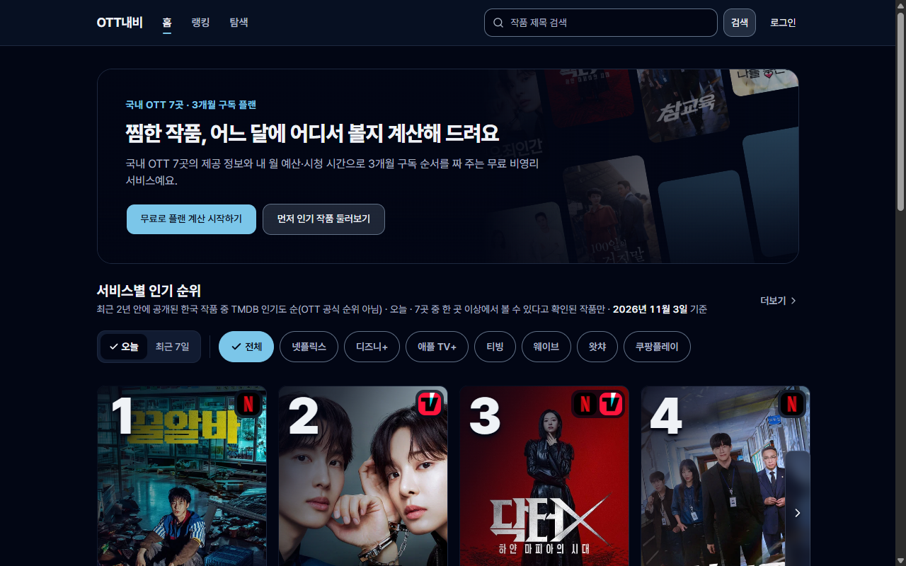

</div>

## 이런 서비스입니다

**OTT를 이곳저곳 다 구독하기에는 매달 나가는 돈이 너무 많습니다.** 그래서 "보고 싶은 영화나 시리즈를 기준으로, OTT를 효율적으로 구독할 수는 없을까?" 하는 생각에서 OTT내비를 만들었습니다.

예를 들어 보고 싶은 작품이 넷플릭스에 2편, 티빙에 1편, 웨이브에 1편 있다고 해 보겠습니다. 요금이 각각 13,500원·13,500원·10,900원일 때, 세 곳을 3개월 내내 구독하면 113,700원이 듭니다. 하지만 이번 달엔 넷플릭스에서 두 편을 보고, 다음 달엔 티빙, 그다음 달엔 웨이브로 옮겨 가면 같은 작품을 37,900원에 볼 수 있습니다. OTT내비는 이 순서를 직접 따져 보는 대신, 찜한 작품과 월 예산·월 시청 시간으로 **달마다 어디를 구독하면 좋을지 3개월 플랜**으로 계산해 줍니다. 한 시즌이 긴 드라마는 두 서비스에 걸쳐 나눠 보는 경우까지 반영하고, 매달 데이터를 다시 수집해 플랜을 다시 계산한 뒤 이메일로 알려 줍니다.

<sub>위 요금과 작품 수는 설명을 위한 예시입니다. 실제 플랜은 요금제, 예산, 시청 시간, 시즌 순서를 함께 따져 계산합니다.</sub>

또 하나의 불편도 있었습니다. 넷플릭스에서 보고 싶은 영화를 검색했는데 없어서, 어느 OTT에 있는지 몰라 네이버와 구글을 오가며 직접 찾아야 했습니다.

| 이런 고민이 있다면 | OTT내비가 하는 일 |
|---|---|
| OTT를 다 구독하기엔 매달 나가는 돈이 부담된다 | 찜한 작품 기준으로 **어느 달에 어디를 구독할지** 3개월 플랜을 계산합니다. |
| 이 작품, 어느 OTT에 있지? | 작품을 검색하면 7개 서비스의 제공 여부를 **있음 / 없음 / 모름**으로 보여 줍니다. 드라마는 시즌별로 확인합니다. |
| 구독하려던 작품이 빠지거나 요금이 바뀌면? | 매월 데이터를 다시 수집해 플랜을 재계산하고, **무엇이 왜 바뀌었는지**를 기록해 이메일로 알려 줍니다. |

### 이렇게 사용합니다

1. **둘러보기**: 로그인 없이 검색, 서비스별 인기 순위, 장르 탐색, 독점 작품 목록을 볼 수 있습니다.
2. **로그인과 설정**: Google로 로그인하고 월 예산·월 시청 시간·지금 구독 중인 서비스를 입력합니다.
3. **찜하기**: 보고 싶은 작품(최대 20개)을 찜하고 **꼭 / 보고 싶음 / 여유될 때**로 우선순위를 정합니다.
4. **계산하고 저장**: 요금을 확인하고 계산하면 **추천형 · 절약형 · 간편형** 3가지 플랜이 나옵니다. 마음에 드는 것을 저장하면 현재 플랜이 됩니다.

> 로그인 없이 써 보고 싶다면 로그인 화면의 **데모 계정으로 로그인** 버튼을 사용할 수 있습니다(회원 기능과 관리자 조회만 가능, 탈퇴·알림 설정 변경은 막혀 있습니다).

## 숫자로 보는 OTT내비

| | | | |
|---|---|---|---|
| **7곳** <br>연동 OTT | **33,190건** <br>수집한 작품 | **280,112건** <br>저장한 제공 상태 | **66 / 70** <br>제공 상태 정확도 표본 |
| **63개** <br>API (계약 우선) | **25개** <br>DB 테이블(마이그레이션 12단계) | **1,465개** <br>백엔드 테스트 메서드 | **10.3ms** <br>검색 평균(3글자 이상, 로컬) |

<sub>수집 규모는 2026-10-27 첫 전체 수집 직후 값입니다. 테스트 수는 `@Test`·`@ParameterizedTest` 개수이고, 성능 수치는 로컬 기준선입니다([성능 측정](#성능-측정)).</sub>

## 목차

[주요 기능](#주요-기능) · [계산 엔진](#계산-엔진) · [데이터 수집과 정확도](#데이터-수집과-정확도) · [시스템 구성](#시스템-구성) · [개발 방식](#개발-방식) · [성능 측정](#성능-측정) · [운영과 관측](#운영과-관측) · [로컬에서 실행하기](#로컬에서-실행하기) · [문서 읽는 법](#문서-읽는-법) · [참고한 자료와 출처](#참고한-자료와-출처)

---

## 주요 기능

### 1. 공개 화면 (로그인 없이)

<table>
<tr>
<td width="50%"><b>작품 검색</b><br>제목으로 검색하면 7개 서비스의 제공 상태를 배지로 보여 줍니다. 쿠팡플레이는 데이터가 부족해 따로 표시합니다.<br>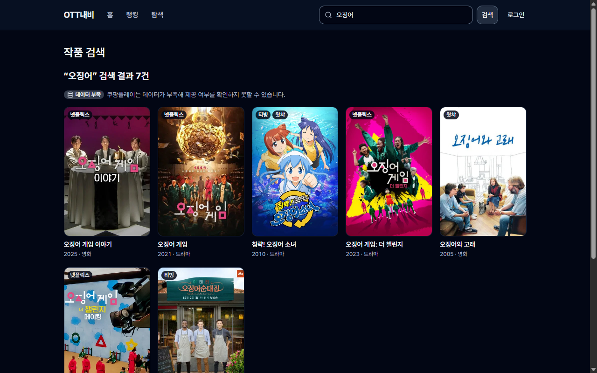</td>
<td width="50%"><b>작품 상세</b><br>줄거리, 장르, 시즌별 제공처와 총 시청 시간을 보여 줍니다. 드라마는 시즌 중 하나라도 제공되면 "있음"입니다.<br>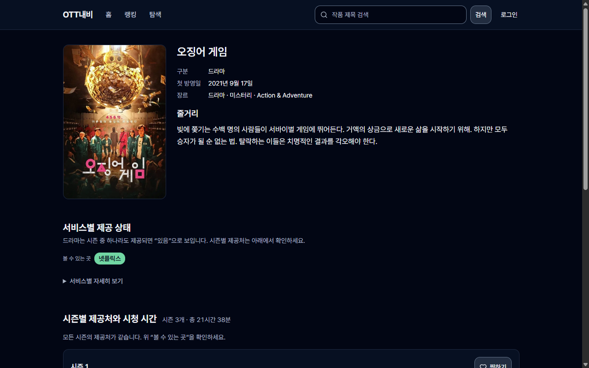</td>
</tr>
<tr>
<td width="50%"><b>서비스별 인기 순위</b><br>서비스마다 최근 2년 안 한국 작품의 인기 순위를 오늘 / 최근 7일 기준으로 보여 줍니다. 찜 많은 작품 순위도 있습니다.<br>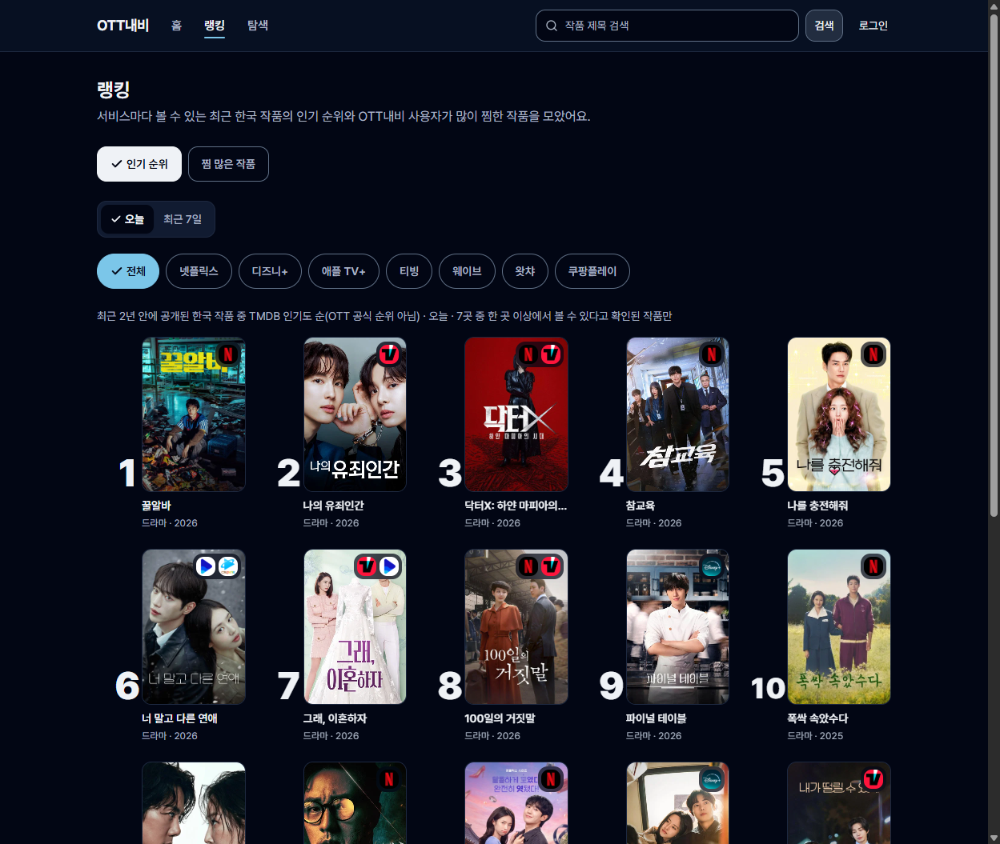</td>
<td width="50%"><b>탐색</b><br>장르와 작품 구분으로 고르고, 새로 볼 수 있게 된 작품만 모아 볼 수 있습니다.<br>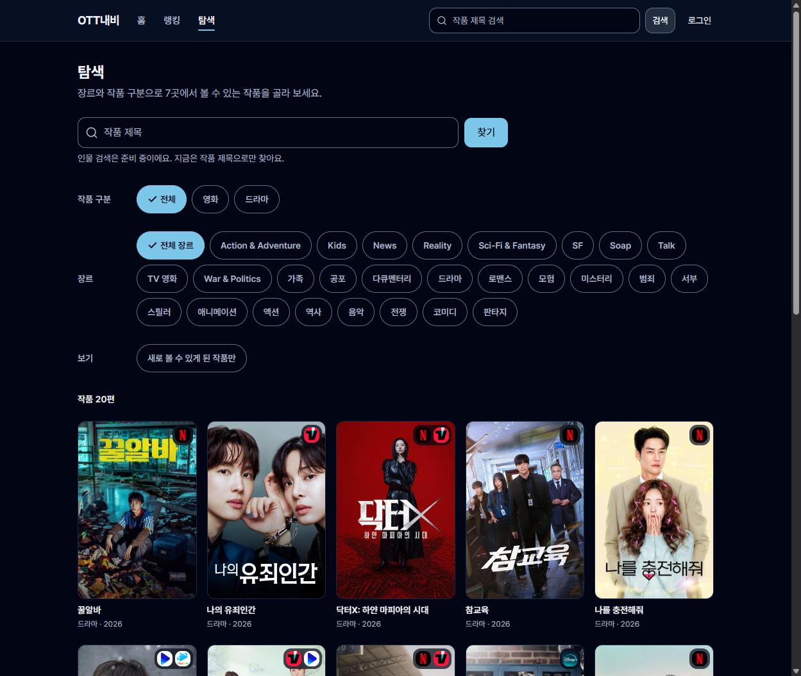</td>
</tr>
<tr>
<td width="50%"><b>독점 작품 목록</b><br>"7곳 중 이 서비스에서만 구독으로 볼 수 있는" 작품을 서비스별로 보여 줍니다. 확인된 범위라는 점과 산정 기준을 함께 안내합니다.<br>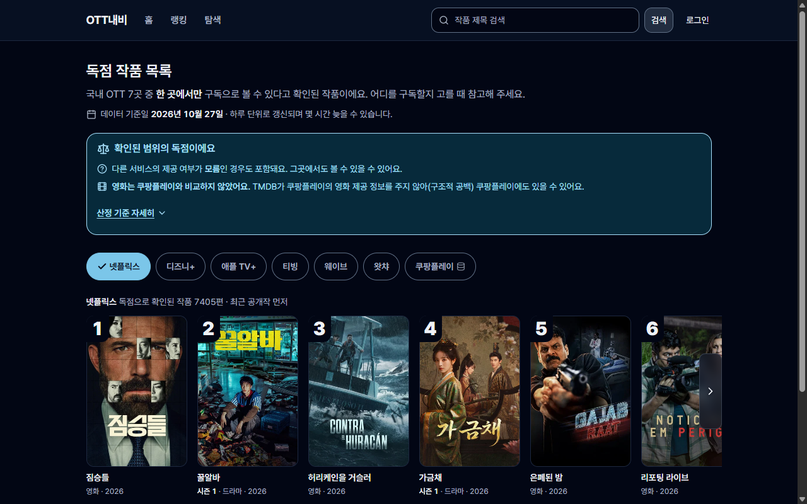</td>
<td width="50%"><b>모바일</b><br>375px 폭까지 반응형으로 동작합니다. 제공 상태는 색뿐 아니라 글자·아이콘으로도 구분합니다.<br>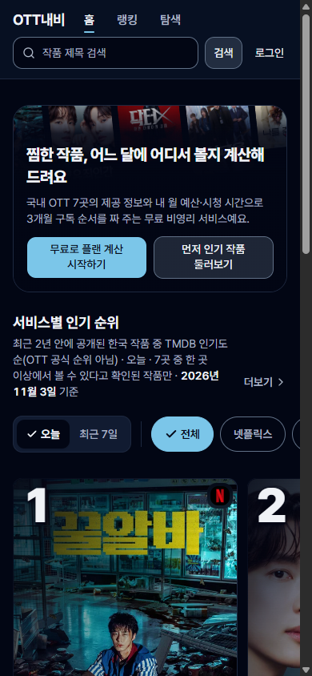</td>
</tr>
</table>

### 2. 회원 기능

로그인 → 내 설정 → 찜 → 요금 확인 → 플랜 계산·저장 → 변경 내역·알림으로 이어집니다.

<table>
<tr>
<td width="50%"><b>로그인</b><br>Google 로그인과 데모 계정 로그인을 제공합니다.<br>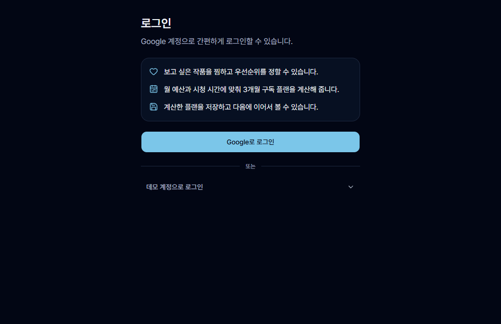</td>
<td width="50%"><b>찜하기와 우선순위</b><br>작품이나 시즌을 찜하면 <b>꼭 볼 작품 / 보고 싶음 / 여유될 때</b> 중 우선순위를 고릅니다.<br>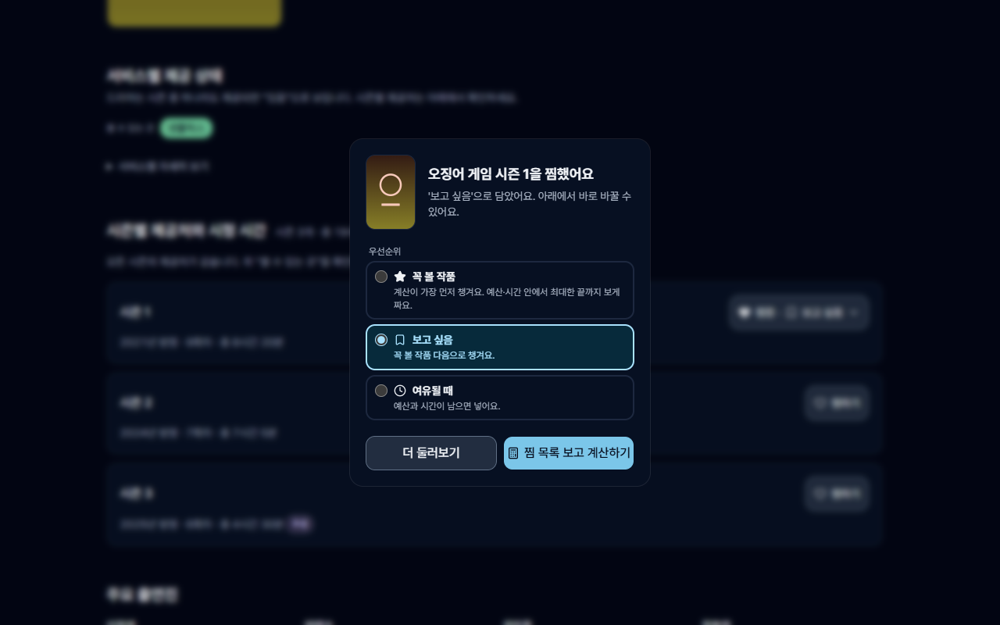</td>
</tr>
<tr>
<td width="50%"><b>내 설정</b><br>지금 쓰는 서비스와 요금제, 월 시청 시간, 월 예산, 저렴한 요금제 포함 여부를 입력합니다.<br>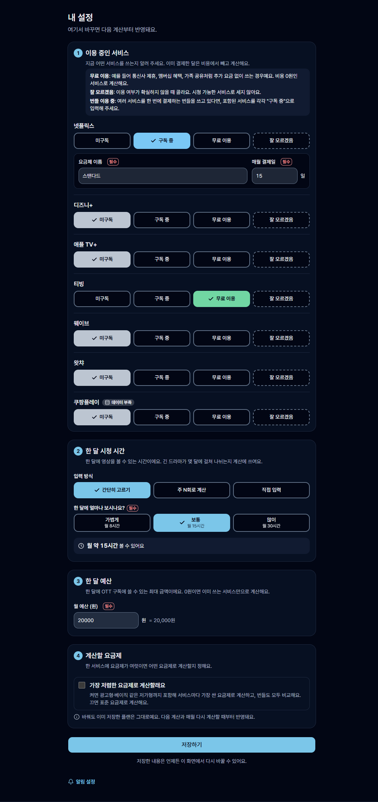</td>
<td width="50%"><b>찜 목록</b><br>우선순위별로 묶어 보고, 작품마다 볼 수 있는 서비스와 필요한 시청 시간, "이미 시청 가능"을 보여 줍니다. 다 본 작품은 체크해 계산에서 뺍니다.<br>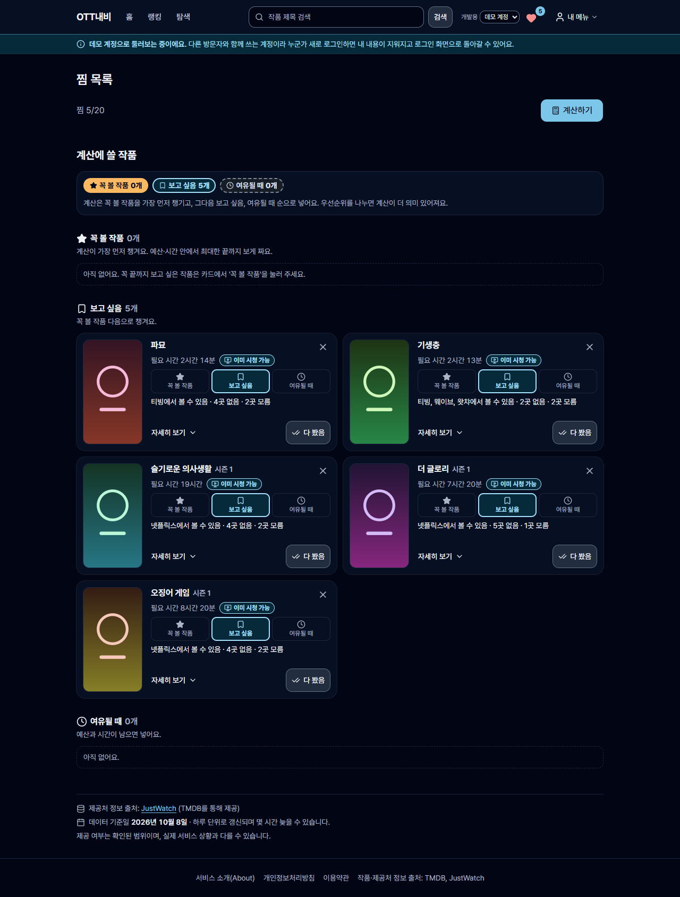</td>
</tr>
</table>

<p align="center">
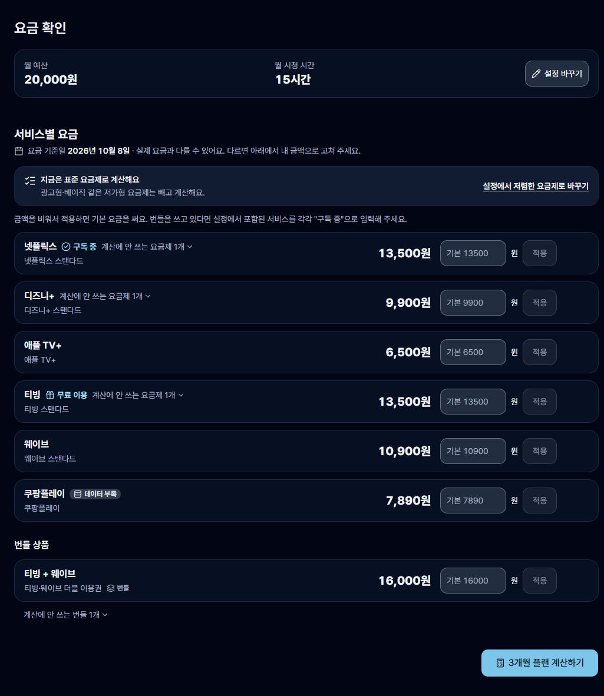<br>
<sub>요금 확인: 서비스별 기본 요금과 번들 상품을 보여 주고, 내 요금으로 고쳐서 계산할 수 있습니다 (목업 데이터)</sub>
</p>

<p align="center">
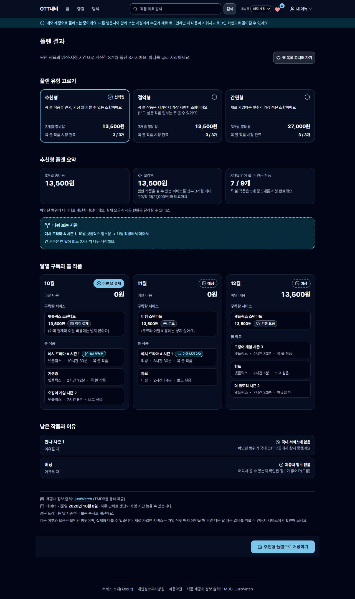<br>
<sub><b>계산 결과</b>: 추천형·절약형·간편형 3종, 3개월 총비용과 절감액, 긴 시즌을 나눠 보는 안내, 달별 구독 서비스와 볼 작품, 못 본 작품과 이유 (목업 데이터)</sub>
</p>

| 기능 | 설명 |
|---|---|
| **찜·우선순위·시청 체크** | 최대 20개, 꼭 / 보고 싶음 / 여유될 때, "다 봤음" 체크 |
| **요금 확인과 수정** | 관리자가 관리하는 기본 요금표를 보여 주고, 내 요금으로 고쳐 계산할 수 있음. 90일 지난 요금에는 "확인일 오래됨" 표시 |
| **번들·저가형 요금제** | 2곳 이상을 묶은 번들 상품을 계산에 쓰고, "가장 저렴한 요금제로 계산" 모드에서는 광고형 같은 저가형을 포함 |
| **3개월 플랜 3종** | 이번 달 확정 + 다음 두 달 예상, 달마다 볼 작품, 남은 작품과 이유, 전체 구독 대비 절감액 |
| **플랜 저장과 변경 내역** | 저장하면 현재 플랜이 되고, 데이터가 바뀌어 재계산되면 무엇이 달라졌는지 기록해 보여 줌 |
| **월초·변경 알림 메일** | 가입·해지 예약 안내, 확정 플랜 작품이 빠질 때 변경 알림. 알림은 기본 꺼짐이고 켠 사람에게만 발송 |
| **탈퇴와 데이터 삭제** | 찜·설정·플랜·대기 중 알림을 삭제하고, 탈퇴 후에는 그 사용자의 데이터가 조회되지 않음 |

#### 알림 메일 예시

플랜을 저장하면 **저장 직후 안내 메일**이, 매월 1일에는 **재계산 결과 메일**이 갑니다. 데모 계정은 메일을 실제로 보내지 않고, 저장할 때 아래 예시를 화면으로 보여 줍니다.

<table>
<tr>
<td width="50%">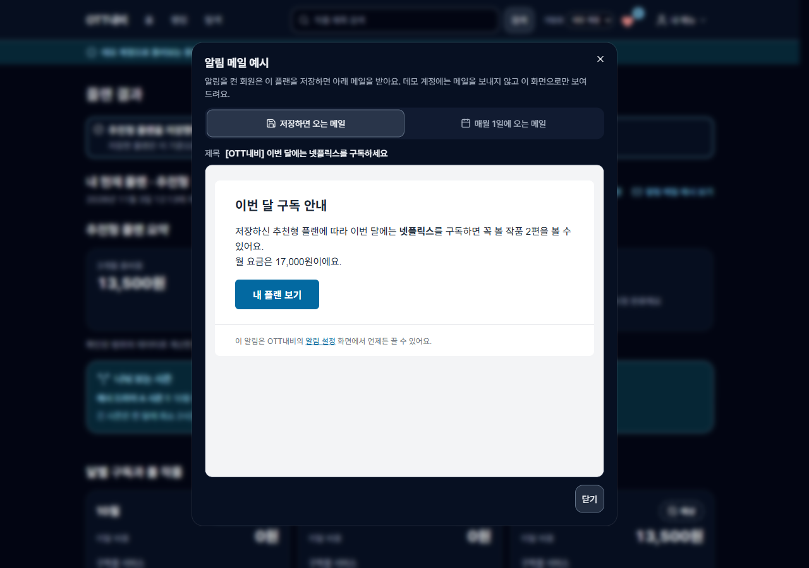</td>
<td width="50%">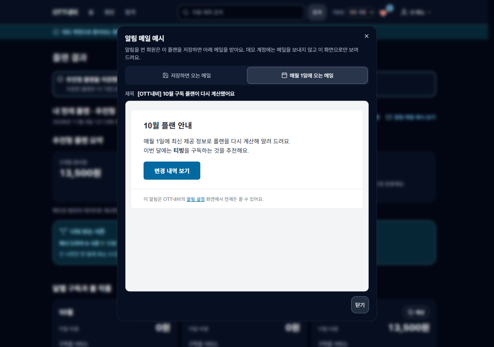</td>
</tr>
</table>
<p align="center"><sub>저장하면 오는 메일(왼쪽)과 매월 1일에 오는 메일(오른쪽) 예시 (목업 데이터, 메일 속 금액은 예시 값)</sub></p>

#### 변경 내역과 알림 설정

<table>
<tr>
<td width="50%"><b>플랜 변경 내역</b><br>매월 재계산 뒤 플랜이 바뀐 때만 기록합니다. 무엇이(새로 들어옴·서비스에서 빠짐·가격 변경·다 봤음 체크) 왜 바뀌었는지, 달별 구독과 작품이 이전과 이후로 어떻게 달라졌는지 보여 줍니다.<br>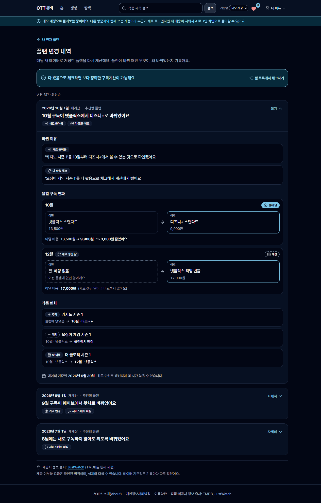</td>
<td width="50%"><b>알림 설정</b><br>이메일 알림은 기본 꺼짐이고, 켜기 전에는 어떤 메일도 보내지 않습니다. 구독 안내·월초 안내·플랜 변경 알림 3종과 발송 이력을 확인합니다.<br>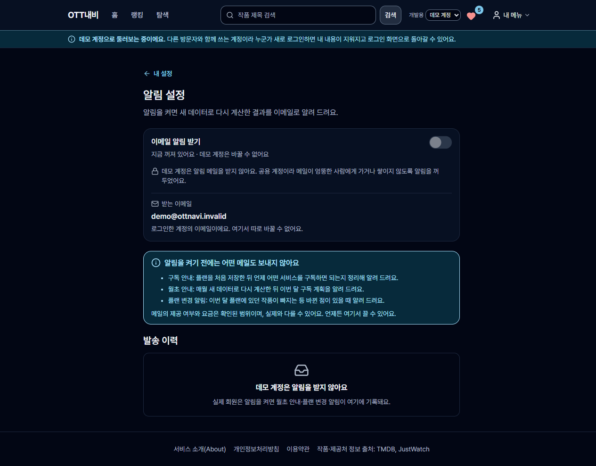</td>
</tr>
</table>
<p align="center"><sub>목업 데이터로 찍은 화면입니다 (데모 계정)</sub></p>

### 3. 관리자 기능

수집·요금·매핑·번역 같은 운영 작업을 관리자 화면에서 합니다. 관리자 권한 검사는 서버가 하고, 화면 가드는 편의 기능입니다.

| 화면 | 하는 일 |
|---|---|
| **OTT 구독상품·요금** | 단품·번들·저가형 상품 등록, 월 구독요금(적용 시작일 기준 이력), 요금 확인일 관리 |
| **제공처 매핑** | TMDB 제공처를 우리 서비스 7곳에 매핑(매핑됨 / 관련 없음 / 미매핑 필터), 광고형 같은 등급 지정 |
| **수집 실행·이력** | 수집 수동 실행, 중단된 실행 복구·재시작, 실행 이력, 변경된 작품, 재계산 대상, 알림 발송 상태 |
| **모니터링** | 회원 현황, 알림 메일 발송, 동의한 방문자 수(GA4), Grafana·Cloudtype 바로가기 |
| **LLM 번역 도구** | 영어 줄거리를 Gemini로 한국어 번역, 성공·주의·실패 3등급 검사, 초안 수정, 일괄 반영, 영어로 되돌리기 |

<table>
<tr>
<td width="50%"><b>상품·요금</b><br>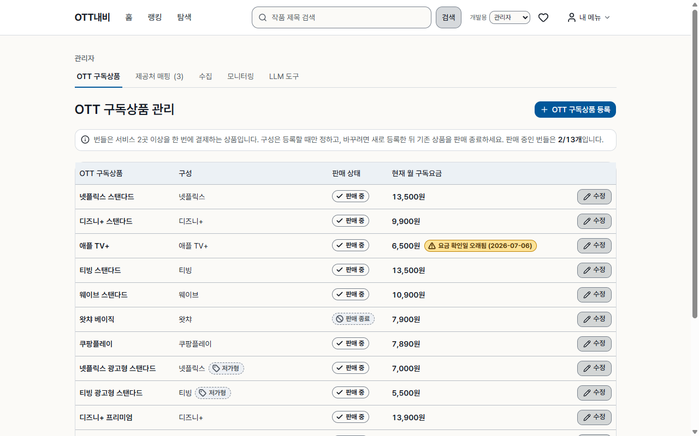</td>
<td width="50%"><b>제공처 매핑</b><br>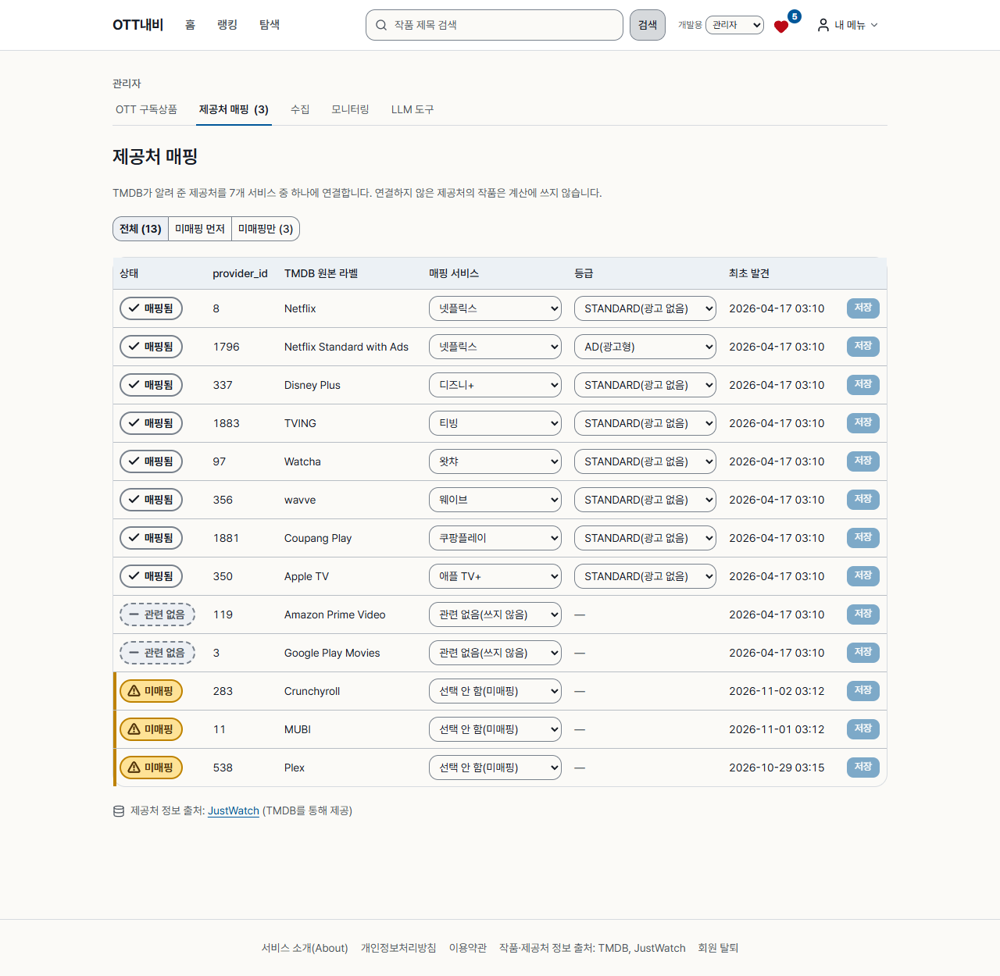</td>
</tr>
<tr>
<td width="50%"><b>수집 실행·이력</b><br>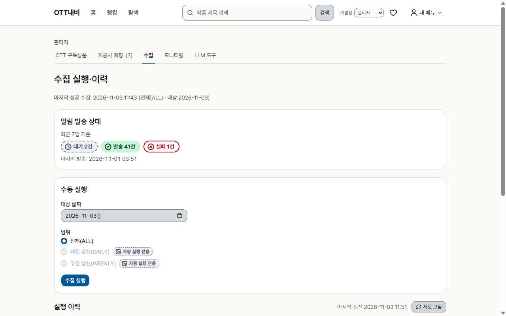</td>
<td width="50%"><b>LLM 줄거리 번역</b><br>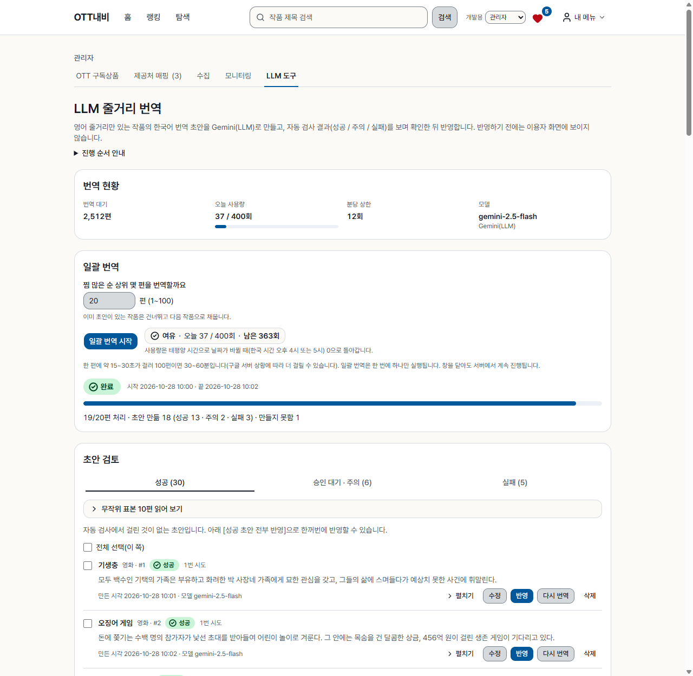</td>
</tr>
</table>
<p align="center"><sub>관리자 화면 (목업 데이터로 찍은 화면, 숫자와 이력은 실제 운영 값이 아닙니다)</sub></p>

#### 모니터링: Google Analytics 4와 Grafana Cloud

- **방문자 통계는 Google Analytics 4**를 씁니다. 방문 통계에 동의한 방문자만 집계하고, 서버가 GA4 Data API를 대신 호출해 15분 캐시한 값(오늘·어제·최근 7일·30일)을 관리자 화면 카드로 보여 줍니다. 연동 설정이 없으면 "연동 안 됨"으로 꺼지고, 조회에 실패해도 화면은 정상 응답합니다.
- **서버 상태는 Grafana Cloud**를 씁니다. Micrometer가 OTLP로 지표를, Loki4j가 로그를, 요청 추적(Tracing)이 구간별 시간을 보냅니다. 관리자 화면의 바로가기 카드에서 대시보드와 경고·오류 로그로 바로 들어갑니다.

<p align="center">
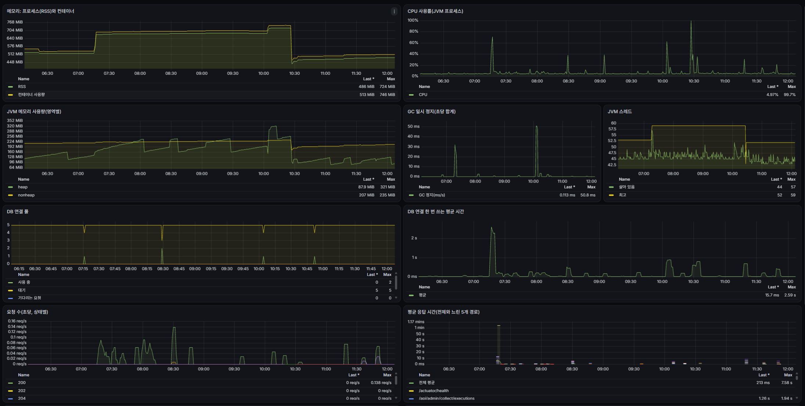<br>
<sub>운영 서버의 Grafana 대시보드 <b>ottnavi 운영 개요</b> (2026-11-03 오전~낮): 메모리(RSS·컨테이너), CPU, JVM 영역별 메모리, GC 일시 정지, 스레드, DB 연결 풀, 요청 수, 응답 시간</sub>
</p>

그래프에서 07시대의 상승은 밤새 비어 있던 캐시를 첫 방문이 즉석에서 계산한 구간으로 추정하고, 10시대의 상승이 일일 수집입니다. 10시 19분에 재배포하면서 메모리가 내려갑니다(이 구간 RSS 최대 724MiB, 컨테이너 최대 746MiB).

#### LLM 번역 도구: 개발은 마쳤지만 운영에는 적용하지 못했습니다

TMDB는 영어 줄거리만 있는 작품이 많아서, **Gemini로 한국어 번역 초안을 만들고 관리자가 검토한 뒤 반영**하는 도구를 만들었습니다. 번역은 3등급(성공·주의·실패)으로 자동 검사하고, 반영하기 전에는 이용자 화면에 보이지 않으며, 언제든 영어 원문으로 되돌릴 수 있습니다. 기능은 개발과 로컬 테스트까지 마쳤지만, **TMDB에 문의한 답변을 받지 못해 운영 환경에는 넣지 못했습니다.** 운영 서버에는 `GEMINI_API_KEY`를 넣지 않아 이 기능이 꺼져 있고, 이용자 화면은 영어 줄거리를 그대로 보여 줍니다.

### 4. 신뢰와 안전

- **출처와 한계를 숨기지 않습니다**: 화면마다 TMDB·JustWatch 출처를 표기하고, 결과는 "확정"이 아니라 **"확인된 범위"** 로 표현하며 데이터 기준일을 보여 줍니다.
- **요청 제한**: 로그인하지 않은 공개 API는 IP당 분당 60회로 제한합니다(초과 시 429).
- **데이터 보관 기한(TMDB 약관)**: 작품 데이터가 보관 기한을 넘기지 않도록, 5개월에 가까운 작품은 TMDB에 먼저 다시 확인해 갱신하고 "없다"고 답한 작품만 삭제하는 정리 Job을 주 1회 돌립니다.
- **개인정보**: 개인정보처리방침·이용약관 화면, 방문 통계(GA4)는 동의한 방문자만 집계, 로그에는 이메일을 마스킹하고 검색어는 남기지 않음.
- **접근성**: 키보드 이동, 본문 건너뛰기 링크, 색만으로 상태를 구분하지 않는 표시.
- **검색 노출**: Google Search Console에서 소유를 확인하고 `sitemap.xml`을 제출했습니다(발견된 페이지 6개). `robots.txt`로 로그인·관리자 화면은 검색에서 빼고, 이전 주소 `ottnavi.vercel.app`은 `ottnavi.shop`으로 영구 이동(308)합니다.

<table>
<tr>
<td width="50%"><b>서비스 소개와 출처 고지</b><br>사용 방법, 제공 상태 읽는 법, TMDB 고지문, 비영리 운영 안내를 담았습니다.<br>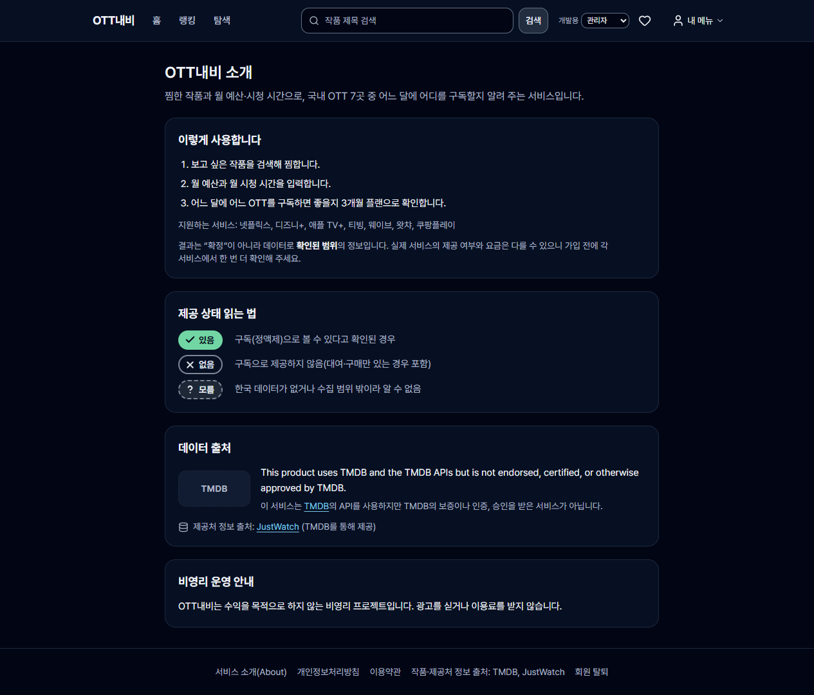</td>
<td width="50%"><b>회원 탈퇴</b><br>삭제되는 데이터를 먼저 보여 주고 동의해야만 탈퇴할 수 있습니다. 공용 데모 계정은 탈퇴할 수 없습니다.<br>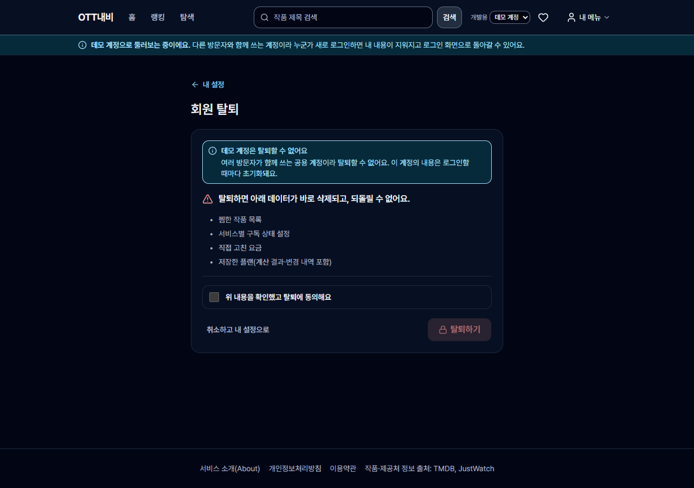</td>
</tr>
</table>

---

## 계산 엔진

플랜 계산은 프레임워크에 의존하지 않는 순수 Java 모듈(`backend/.../engine`)이고, `plan` 도메인만 호출합니다.

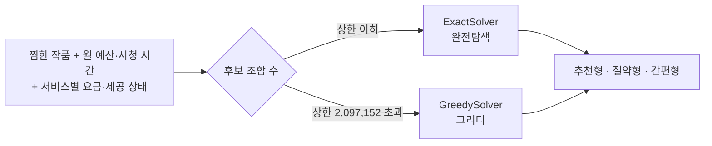

| 구분 | 내용 |
|---|---|
| **완전탐색** | 후보 구독 조합을 모두 훑어 가장 좋은 하나를 고릅니다. 비교 순서: 꼭 시청 완료 수 → 점수 → 총비용 → 조기 시청 → 결제 미루기 → 상품 ID |
| **그리디** | 조합이 너무 많을 때만 쓰는 안전장치. 같은 `PlanSolver` 인터페이스를 공유 |
| **플랜 유형** | 같은 입력에서 추천형(꼭 볼 작품 우선) / 절약형 / 간편형을 계산 |
| **규칙** | 같은 시리즈의 시즌은 번호 순서대로 시청 완료, 찜은 최대 20개, 절감액 = 전체 구독 비용 − 플랜 총비용 |
| **상태 전이** | DRAFT(계산 결과) → ACTIVE(저장) → ARCHIVED. 사용자당 ACTIVE는 1개, 저장하면 고른 유형만 남기고 나머지 DRAFT는 삭제 |

운영 서버에서 두 알고리즘을 정답 세트 21개로 비교한 기록이 `calc_run` 테이블에 남아 있습니다(2026-10-28).

| 케이스 | 후보 조합 | 완전탐색 | 그리디 | 비용 차이 |
|---|---|---|---|---|
| 실제 국내 OTT 조합 | 1,152개 | 약 34ms | 약 0.15ms | 그리디가 5,500원 더 비쌈 |
| 상한의 약 19%인 입력 | 389,017개 | 약 2.29초 | 약 0.66ms | 그리디가 10,400원 더 비쌈 |

현재 규모(찜 20개 이하, 상품 7개 안팎)에서는 완전탐색이 충분히 빠르고 그리디보다 정확합니다. 알고리즘 설명은 [`ENGINE_ALGORITHM.md`](docs/guides/ENGINE_ALGORITHM.md), 설계 근거는 [`TECH.md`](docs/TECH.md) 1절에 있습니다.

<p align="center">
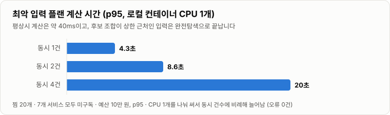
</p>

---

## 데이터 수집과 정확도

작품·시즌·제공 상태는 TMDB에서 매일·매주 수집합니다. GitHub Actions cron이 관리자 API를 호출하면 Spring Batch Job이 단계별로 실행됩니다.

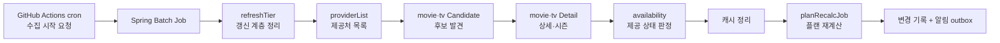

| 항목 | 내용 |
|---|---|
| **갱신 주기** | 일간(DAILY): 찜한 작품만 매일 / 주간(WEEKLY): 후보 발견부터 나머지 작품 전체 / 인기 순위: 매일 별도 Job / 오래된 데이터 정리: 별도 Job |
| **안전장치** | 같은 날짜·계층 중복 실행은 409, 중단된 실행은 복구·재시작, 외부 호출은 재시도·속도 제한 |
| **제공 상태 판정** | 작품·시즌별 제공처 조회의 **구독(flatrate)** 만 "있음". 대체 판정(시즌 → 작품 단위)과 구조적 공백(쿠팡플레이 영화 등)은 "모름"·"데이터 부족"으로 표시 |

<p align="center">
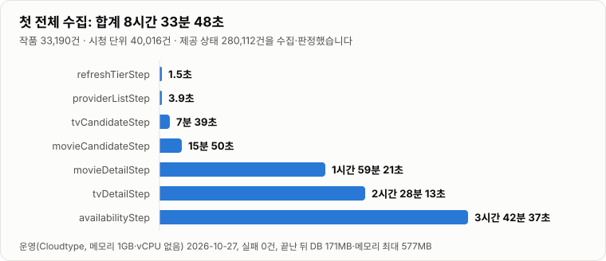
</p>

### 정확도 검증

"구독 제공"으로 판정한 약 6만 건에서 서비스마다 10건씩 무작위로 뽑아 실제 앱에서 확인했습니다(2026-10-19). 결과와 한계는 [정확도 안내 화면](https://ottnavi.shop/accuracy)에 그대로 공개합니다.

<p align="center">
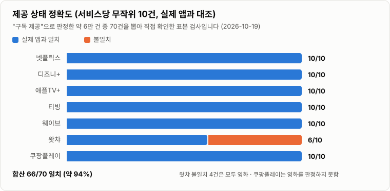
</p>

한계도 함께 밝힙니다: 서비스당 10건은 표본이 작고, 재현율(앱에 있는 작품을 얼마나 찾았는가)은 측정하지 않았으며, 쿠팡플레이는 영화를 판정하지 못합니다. 그래서 정확도를 정밀하게 말하지 않고 "확인된 범위"로 표기합니다(PRD 8.2절).

<p align="center">
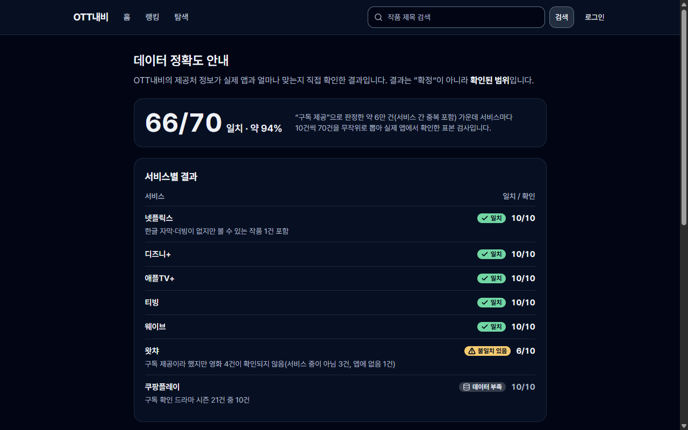
</p>

---

## 시스템 구성

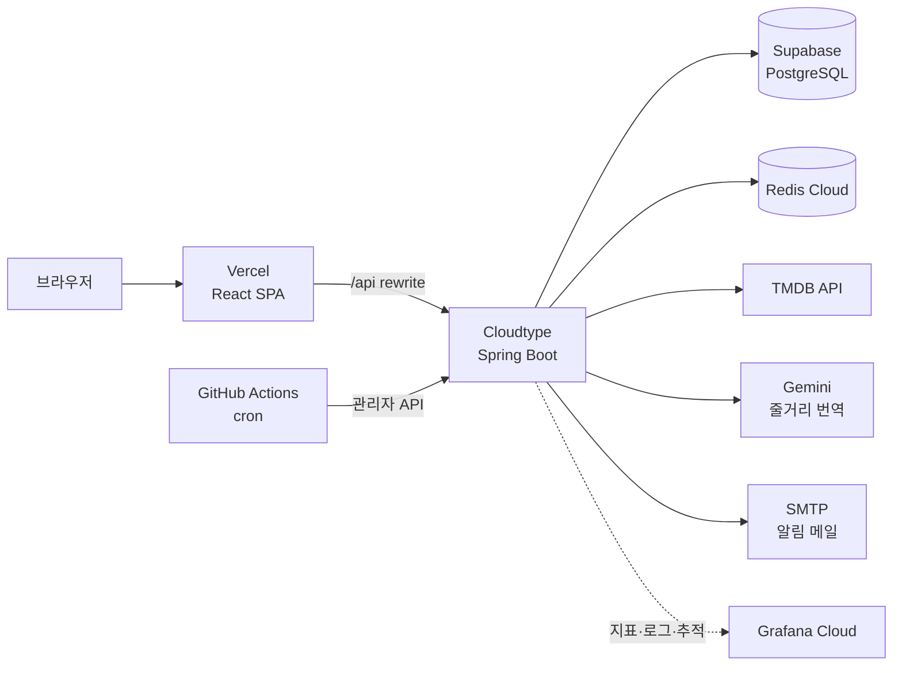

### 데이터베이스 구조

서비스 테이블 25개를 작품·데이터, 상품·요금, 사용자, 플랜, 알림·운영 다섯 영역으로 나눴습니다. 영화와 드라마 시즌은 `watch_unit`(시청 단위)으로 통일해 찜·제공 상태·계산이 모두 이 테이블을 기준으로 동작합니다(전체 도식과 컬럼은 [`ERD.md`](docs/ERD.md)).

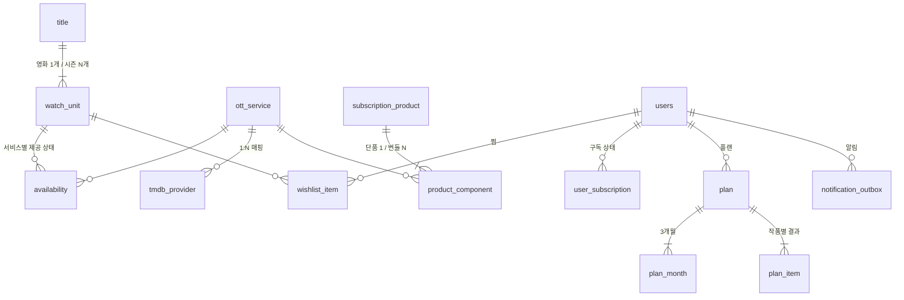

### 기술 스택

| 영역 | 사용 기술 |
|---|---|
| **프론트엔드** | React 19, TypeScript 6, Vite 8, Tailwind CSS 4, shadcn/ui, TanStack Query(서버 상태), Zustand(인증만), React Hook Form + Zod, orval(타입·훅·MSW 목업 생성), Vitest |
| **백엔드** | Java 17, Spring Boot 4.1, Spring Data JPA, Spring Batch, Spring Security, OpenFeign, Flyway, JUnit 5 + Testcontainers + WireMock |
| **데이터** | PostgreSQL 17(운영 Supabase), Redis 8.6(캐시·Refresh Token·요청 제한), `pg_trgm` 검색 인덱스 |
| **인프라** | Vercel(프론트), Cloudtype(백엔드), Supabase, Redis Cloud, GitHub Actions(CI·수집 cron), Docker Compose(로컬) |
| **외부 연동** | TMDB API, Google OAuth2, Google Analytics 4 Data API, Gemini(관리자 번역), SMTP |
| **관측·성능** | Micrometer + OTLP, Loki4j, Grafana Cloud(지표·로그·추적), k6 |

### 인증과 보안

- **Google OAuth2 → JWT**: Access Token은 30분이고 프론트 메모리에만 두며, Refresh Token은 HttpOnly 쿠키(`Path=/api/auth`)로 회전하고 재사용을 탐지합니다.
- **API 경로 3분류**: `/api/public/**`(비로그인, 요청 제한) · `/api/**`(로그인) · `/api/admin/**`(ADMIN). 데모 계정은 읽기 전용 관리자 조회만 가능합니다.
- **오리진 비밀 헤더**: 프록시를 거치지 않은 직접 호출을 막고, 수집 cron은 비밀 헤더와 배치 토큰으로 호출합니다.
- **외부 호출은 트랜잭션 밖에서** 하고(수집 배치만 예외), 삭제는 외래 키 `ON DELETE CASCADE`와 벌크 쿼리로 처리합니다.

---

## 개발 방식

| 방식 | 내용 |
|---|---|
| **API 계약 우선** | [`docs/api/openapi.yaml`](docs/api/openapi.yaml)이 프론트와 백엔드를 묶는 유일한 계약입니다. 계약을 고치면 orval이 타입·훅·MSW 목업을 만들고, 백엔드가 만든 명세와 다르면 CI가 실패합니다. |
| **목업 먼저, API는 하나씩 교체** | 화면을 MSW 목업으로 먼저 세우고 실제 API로 한 개씩 연결했습니다. |
| **문서 기반 결정** | 요구사항·계산 규칙·결정 이력을 PRD(결정 번호 R11-N)·ERD·TECH에 남기고, 어긋나면 임의로 고르지 않고 올립니다. |
| **계층 규칙** | 백엔드는 도메인별 `controller → service → domain` 단방향, 다른 도메인의 리포지토리는 직접 쓰지 않습니다. |
| **스키마는 마이그레이션으로만** | Flyway 12단계, 병합된 파일은 고치지 않고 새 버전을 추가합니다. |
| **브랜치·병합** | `develop` 통합, `feature/*` → PR → Squash 병합, `main` 병합이 곧 운영 배포입니다. CI(`backend-ci`, `frontend-ci`)가 필수입니다. |

| 규모 | |
|---|---|
| 백엔드 | Java 소스 676개, 테스트 파일 229개, 테스트 메서드 1,465개 |
| 프론트엔드 | TypeScript 파일 383개(생성 코드 제외), 테스트 파일 79개 |
| API | 63개 operation(모두 구현), 오류 코드표 `docs/api/error-codes.md` |

---

## 성능 측정

운영 서버에 부하를 걸 수 없어서, 같은 조건(메모리 1GiB, CPU 1개, 힙 512MB)의 로컬 컨테이너에 **k6**로 부하를 걸어 평소 속도, 한계, 최악 입력, 메모리를 쟀습니다. **로컬 기준선이며 운영 수치가 아닙니다.**

| 질문 | 답 |
|---|---|
| 평소 얼마나 빠른가 | 검색 약 70ms, 상세 2~7ms, 홈 인기 순위 약 2ms, 평상시 플랜 계산 약 40ms |
| 최악 입력은 | 찜 20개·7곳 모두 미구독: 1건 3.7초(완전탐색으로 끝남), 동시 4건 p95 20초 |
| 메모리는 | 모든 부하에서 컨테이너 최대 580MiB(1GiB의 57%), OOM 0건 |
| 프론트엔드는 | 첫 화면 메인 묶음 384.7KB(gzip 122.3KB), 화면마다 별도 묶음으로 지연 로딩, 찜 상한 20개를 채운 목록도 콘솔 에러 없이 스크롤(2026-10-19 번들 점검) |

### 검색 병목을 찾고 푼 과정

k6로 읽기 한계를 재다 **검색이 먼저 무너지는 것**을 발견했고, 제목 검색에 트라이그램 인덱스(`pg_trgm`)를 넣었습니다. 그런데 **인덱스만 넣으면 2글자 검색이 오히려 느려졌습니다.** PostgreSQL이 준비된 쿼리의 범용 계획을 굳히면서 인덱스 경로를 잘못 고른 것이 원인이었고, 연결 초기화 SQL `SET plan_cache_mode = force_custom_plan`("매번 계획 세우기")으로 해결했습니다. 같은 날, 같은 스크립트로 세 구성을 비교했습니다.

<p align="center">
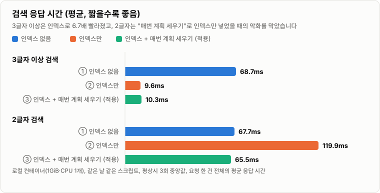
</p>
<p align="center">
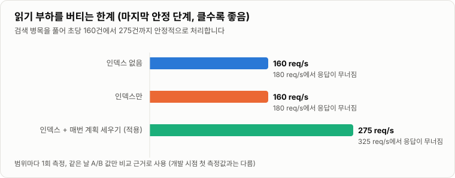
</p>

한 글자 검색은 의미 있는 결과를 낼 수 없어 **검색어 최소 2글자**로 제한했습니다(계약 `minLength` 1 → 2, 백엔드 검증, 프론트 안내). 측정 방법과 전체 결과는 [`K6_PERFORMANCE.md`](docs/guides/K6_PERFORMANCE.md), 원인 분석과 해결 실험은 [`K6_SEARCH_BOTTLENECK.md`](docs/guides/K6_SEARCH_BOTTLENECK.md)에 있습니다.

---

## 운영과 관측

- **배포**: `develop` → `main` 병합이 운영 배포이고, 백엔드는 Cloudtype 콘솔에서 배포하며, 프론트는 Vercel이 `main`을 자동 배포합니다. 첫 공개 `v0.1.0`부터 `v0.2.1`까지 태그로 기록합니다.
- **관측**: Micrometer가 OTLP로 지표를, Loki4j가 로그를, 요청 추적(Tracing)이 구간별 시간을 Grafana Cloud로 보냅니다. 대시보드(요청·응답 시간·메모리·DB 연결 풀)와 알림 규칙(메모리 높음, 지표 끊김)을 운영합니다.
- **개인정보 보호**: 검색어는 로그에 남기지 않고 이메일은 마스킹하며, 추적 데이터에는 개인정보 필터를 둡니다.
- **메모리**: 구독 메모리 1GB에서 운영합니다. 추적을 켠 상태에서 일일 수집 뒤 RSS 최대 722MiB, 컨테이너 최대 744MiB입니다(중단 기준 820/830).
- **운영 기록**: 첫 배포와 첫 전체 수집 과정에서 겪은 문제와 해결은 [`FIRST_DEPLOY_RECORD.md`](docs/guides/FIRST_DEPLOY_RECORD.md), Redis 연결 지연 조사는 [`TROUBLESHOOTING_REDIS_COLD_START.md`](docs/guides/TROUBLESHOOTING_REDIS_COLD_START.md)에 있습니다.

---

## 로컬에서 실행하기

필요한 것: JDK 17, Node.js 20.19 이상(또는 22.12 이상), Docker Desktop. 명령은 PowerShell 기준이고 저장소 루트에서 시작합니다.

**1. DB·Redis 띄우기** (PostgreSQL 17.6, Redis 8.6, 포트는 `127.0.0.1`에만 열립니다)

```powershell
docker compose -f infra/docker-compose.yml up -d
```

**2. 백엔드 실행** (`local` 프로필이 기본이고, DB·JWT·Google 로그인 값은 로컬용 기본값이 있어 `.env` 없이 뜹니다. 처음 뜰 때 Flyway가 스키마를 만듭니다)

```powershell
cd backend
.\gradlew.bat bootRun
```

**3. 프론트엔드 실행** (다른 터미널에서)

```powershell
cd frontend
npm install
npm run dev
```

`http://localhost:5173`을 열면 됩니다. `/api` 요청은 `localhost:8080`으로 넘어갑니다.

처음 만든 로컬 DB는 작품이 비어 있고 구독상품·요금도 없습니다. 하고 싶은 일에 맞게 고르세요.

| 하고 싶은 것 | 방법 |
|---|---|
| 화면만 둘러보기 | 백엔드 없이 목업 데이터로 실행: `$env:VITE_USE_MOCK="true"; npm run dev` (헤더의 "개발용" 선택으로 회원·관리자 화면 전환) |
| 요금 확인·플랜 계산 써 보기 | 요금 시드 입력: `Get-Content infra/dev-seed-products.sql -Raw \| docker exec -i ottnavi-postgres-1 psql -U ottnavi -d ottnavi` |
| 실제 작품 데이터 채우기 | TMDB 읽기 토큰을 `TMDB_API_KEY`로 넣고 관리자 API로 수집 실행([`COLLECT_GUIDE.md`](docs/guides/COLLECT_GUIDE.md)) |
| 실제 Google 로그인 | `GOOGLE_CLIENT_ID`·`GOOGLE_CLIENT_SECRET`을 환경 변수로 지정 |

환경 변수 이름 목록은 [`.env.example`](.env.example)에 있습니다(값은 저장소에 두지 않습니다).

**테스트**

```powershell
cd backend; .\gradlew.bat build          # 통합 테스트가 Testcontainers를 쓰므로 Docker Desktop이 켜져 있어야 합니다
cd frontend; npm run lint
cd frontend; npm run test
cd frontend; npm run build
cd frontend; npm run api:generate        # 계약(openapi.yaml) 변경 후 타입·훅·목업 재생성
```

<details>
<summary><b>폴더 구조</b></summary>

```
backend/   Spring Boot 서버 (패키지 지도: docs/guides/PACKAGE_MAP.md)
 └ com.ottnavi: global(공통·보안) · infra(TMDB·메일·LLM·GA) · catalog · provider · product
                user · wishlist · plan · notification · engine(계산) · collect(수집) · admin
frontend/  React SPA (feature 단위: src/features/{기능}, pages는 얇게)
infra/     로컬 PostgreSQL·Redis(docker-compose), k6 성능 측정
docs/      PRD, ERD, TECH, ROADMAP, 설명 문서(guides), API 계약(api)
.github/   CI(backend-ci, frontend-ci)와 수집·인기 순위·정리 cron 워크플로
```

</details>

---

## 문서 읽는 법

처음 읽는다면 **PRD → ERD → TECH** 순서를 권합니다. 문서끼리 어긋나면 `PRD 11절 확정 → PRD 본문 → ERD → rules` 순서가 기준입니다.

| 알고 싶은 것 | 읽을 문서 |
|---|---|
| 무엇을 왜 만들었나, 요구사항·결정 이력 | [`PRD.md`](docs/PRD.md) (계산 규칙 5.4, 데이터 근거 8.2, 결정 현황 11절) |
| DB 구조와 삭제 정책 | [`ERD.md`](docs/ERD.md) |
| 설계 결정과 함정 (계산 엔진, 플랜 저장, 배치, 인증, 알림 outbox) | [`TECH.md`](docs/TECH.md) |
| 진행 현황과 Task별 검증 | [`ROADMAP.md`](docs/ROADMAP.md) |
| API 계약과 오류 코드 | [`openapi.yaml`](docs/api/openapi.yaml), [`error-codes.md`](docs/api/error-codes.md) |
| 프로젝트를 만든 이유 | [`PROJECT_STORY.md`](docs/PROJECT_STORY.md) |

<details>
<summary><b>설명 문서 (docs/guides)</b></summary>

| 주제 | 문서 |
|---|---|
| 계산 엔진 알고리즘 | [`ENGINE_ALGORITHM.md`](docs/guides/ENGINE_ALGORITHM.md) |
| 매월 재계산 흐름 | [`PLAN_RECALC_FLOW.md`](docs/guides/PLAN_RECALC_FLOW.md) |
| 번들·저가형 요금제 | [`BUNDLE_PRICE_MODE_FLOW.md`](docs/guides/BUNDLE_PRICE_MODE_FLOW.md) |
| 수집 Job과 관리자 API | [`COLLECT_GUIDE.md`](docs/guides/COLLECT_GUIDE.md), [`COLLECT_ADMIN_QA.md`](docs/guides/COLLECT_ADMIN_QA.md), [`SPRING_BATCH_BASICS.md`](docs/guides/SPRING_BATCH_BASICS.md) |
| 제공 상태 판정 규칙 | [`AVAILABILITY_RULES.md`](docs/guides/AVAILABILITY_RULES.md) |
| 내 설정·찜 API 흐름 | [`USER_SETTINGS_WISHLIST_GUIDE.md`](docs/guides/USER_SETTINGS_WISHLIST_GUIDE.md) |
| 백엔드 패키지 지도 | [`PACKAGE_MAP.md`](docs/guides/PACKAGE_MAP.md) |
| Flyway·JPA·OpenFeign | [`FLYWAY_GUIDE.md`](docs/guides/FLYWAY_GUIDE.md), [`JPA_COMPOSITE_KEY_GUIDE.md`](docs/guides/JPA_COMPOSITE_KEY_GUIDE.md), [`OPENFEIGN_GUIDE.md`](docs/guides/OPENFEIGN_GUIDE.md) |
| 도메인·HTTPS 구조 | [`DOMAIN_HTTPS_FLOW.md`](docs/guides/DOMAIN_HTTPS_FLOW.md) |
| 관측·모니터링 | [`OBSERVABILITY_GUIDE.md`](docs/guides/OBSERVABILITY_GUIDE.md) |
| 성능 측정(k6) | [`K6_PERFORMANCE.md`](docs/guides/K6_PERFORMANCE.md), [`K6_SEARCH_BOTTLENECK.md`](docs/guides/K6_SEARCH_BOTTLENECK.md) |
| 첫 배포 기록과 트러블슈팅 | [`FIRST_DEPLOY_RECORD.md`](docs/guides/FIRST_DEPLOY_RECORD.md), [`TROUBLESHOOTING_REDIS_COLD_START.md`](docs/guides/TROUBLESHOOTING_REDIS_COLD_START.md) |

설명 문서는 근거 문서가 아니고, 코드나 PRD·ERD·TECH와 어긋나면 그쪽이 기준입니다.

</details>

---

## 참고한 자료와 출처

### 데이터 출처와 고지

*This product uses TMDB and the TMDB APIs but is not endorsed, certified, or otherwise approved by TMDB.*

- **작품 정보·이미지**: [TMDB](https://www.themoviedb.org/) (The Movie Database)
- **제공처(스트리밍 서비스) 정보**: TMDB가 제공하는 [JustWatch](https://www.justwatch.com/) 기반 데이터. 화면의 제공처 영역마다 출처를 표기합니다.
- 이 서비스는 **비영리**이며 광고나 수익화 요소가 없습니다(TMDB 이용 조건에 맞춤). 제공 여부는 확인된 범위이고 실제 서비스 상황과 다를 수 있습니다.

### 참고한 공식 문서와 도구

| 영역 | 자료 |
|---|---|
| 프레임워크 | [Spring Boot](https://docs.spring.io/spring-boot/), [Spring Batch](https://docs.spring.io/spring-batch/reference/), [Spring Security](https://docs.spring.io/spring-security/reference/), [Flyway](https://documentation.red-gate.com/flyway), [React](https://react.dev/), [Vite](https://vite.dev/), [Tailwind CSS](https://tailwindcss.com/docs), [TanStack Query](https://tanstack.com/query/latest) |
| 데이터베이스 | [PostgreSQL 문서](https://www.postgresql.org/docs/) (`PREPARE`·`plan_cache_mode`, `pg_trgm`), [Redis](https://redis.io/docs/latest/) |
| 외부 API | [TMDB API](https://developer.themoviedb.org/docs), [Google Identity(OAuth2)](https://developers.google.com/identity), [Google Analytics Data API](https://developers.google.com/analytics/devguides/reporting/data/v1) |
| 성능·관측 | [Grafana k6](https://grafana.com/docs/k6/latest/), [Micrometer](https://docs.micrometer.io/), [Grafana Cloud](https://grafana.com/docs/grafana-cloud/) |
| UI·테스트 | [shadcn/ui](https://ui.shadcn.com/), [orval](https://orval.dev/), [MSW](https://mswjs.io/), [Vitest](https://vitest.dev/), [Testcontainers](https://testcontainers.com/) |

버전별 차이가 큰 라이브러리(Spring Boot 4.1의 Jackson 3, orval, msw 3 등)는 설치된 버전의 공식 문서와 타입 정의를 기준으로 확인했고, 알려진 함정은 [`TECH.md`](docs/TECH.md) 6절에 모아 두었습니다.
