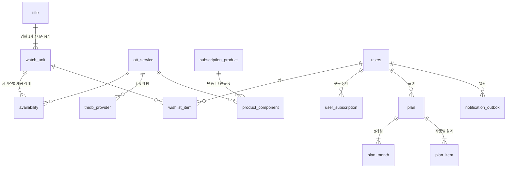
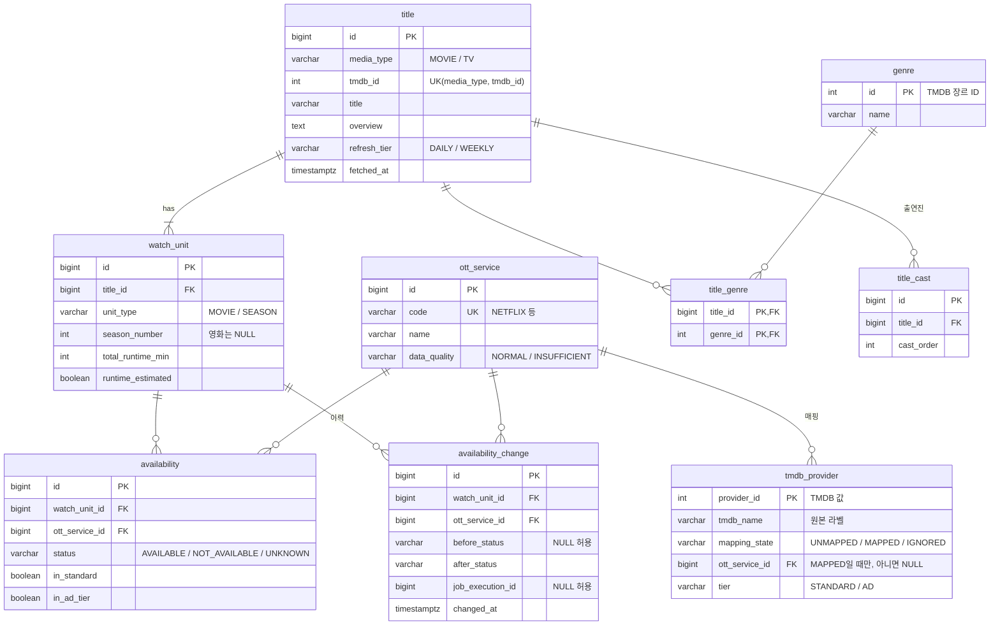
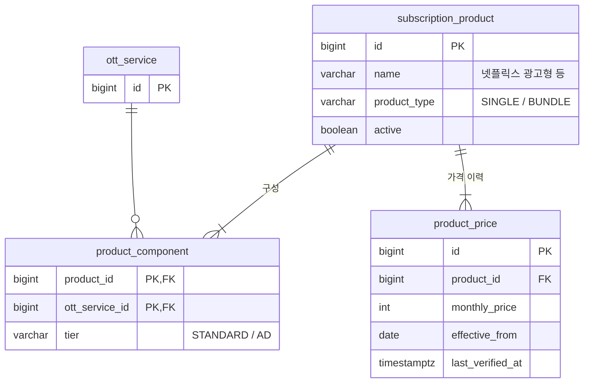
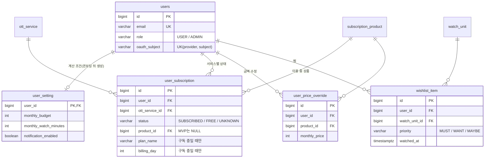
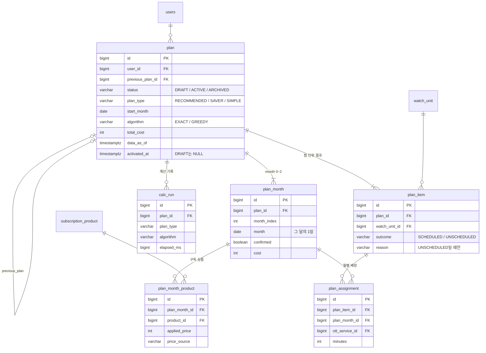

# OTT내비(ottnavi) ERD

초안 v0.4 · 2026-10-13 · PostgreSQL 15+ (Supabase 17.6, 로컬 compose도 17.6) · Spring Data JPA + Flyway

서비스 테이블 24개를 다섯 영역으로 나눴다. 라이브러리가 관리하는 테이블(`BATCH_*`, `shedlock`)은 이 숫자에서 뺐다. 모든 테이블은 내부 대리키(`id BIGINT`)를 기본키로 쓰고(예외: 외부 ID를 그대로 쓰는 `tmdb_provider`·`genre`, 부모의 PK를 그대로 쓰는 `user_setting`, 복합키인 `product_component`·`title_genre`), TMDB 값은 매핑 컬럼과 유니크 제약으로 보관한다. 영화와 드라마 시즌은 `watch_unit`(시청 단위)으로 통일해 찜, 제공 상태, 계산이 모두 이 테이블을 기준으로 동작한다.

- 공통 감사 컬럼 `created_at`, `updated_at`(TIMESTAMPTZ)은 표에서 생략한다.
- 키 표기: **PK** 기본키, **FK** 외래키, **UK** 유니크 제약
- NULL이 될 수 있는 컬럼은 반드시 표시한다(A 영역은 설명 칸에 `NULL 허용`, B~E 영역은 컬럼 이름 뒤에 `NULL`). 표시가 없는 컬럼은 `NOT NULL`이다. `CHECK`는 NULL이면 통과하므로, 열끼리의 규칙 `CHECK`(예: `(status = 'UNKNOWN') = (unknown_reason IS NOT NULL)`)는 이 `NOT NULL` 전제 위에서 성립한다. 마이그레이션에서 `NOT NULL`을 빠뜨리지 않는다. 연결도(mermaid)는 요약이라 NULL 표기를 빠뜨렸을 수 있으니, 어긋나면 각 영역의 상세 표를 정본으로 본다.

---

## 0. 전체 구조

영역 간 연결만 표시했다.

---

## A. 작품·데이터 영역

TMDB에서 수집한 데이터다. 수집 배치만 쓰고, 공개 API(검색·상세·독점 목록)와 계산 엔진이 읽는다.

### ott_service — 우리 7개 서비스

| 컬럼 | 타입 | 키 | 설명 |
|---|---|---|---|
| id | BIGINT | PK | 내부 키 |
| code | VARCHAR(30) | UK | NETFLIX, DISNEY_PLUS, APPLE_TV_PLUS, TVING, WAVVE, WATCHA, COUPANG_PLAY |
| name | VARCHAR(50) | | 화면 표시 이름 |
| logo_path | VARCHAR(200) | | TMDB 이미지 상대 경로 |
| display_order | INT | | 화면 정렬 순서 |
| data_quality | VARCHAR(20) | | NORMAL / INSUFFICIENT. 쿠팡플레이는 INSUFFICIENT |

### tmdb_provider — TMDB 제공처와 서비스 매핑

| 컬럼 | 타입 | 키 | 설명 |
|---|---|---|---|
| provider_id | INT | PK | TMDB 값 그대로 (8, 1796 등). 외부 값이 안정적인 식별자라 대리키를 두지 않는다 |
| tmdb_name | VARCHAR(100) | | TMDB 원본 라벨. 관리자 확인용이며 판정에 쓰지 않는다 |
| logo_path | VARCHAR(200) | | NULL 허용 |
| mapping_state | VARCHAR(20) | | UNMAPPED(미매핑, 처음 발견된 상태) / MAPPED(서비스에 연결됨) / IGNORED(관련 없음). 기본값 UNMAPPED. 판정에는 MAPPED만 쓴다. 수집은 이미 있는 제공처의 상태를 덮어쓰지 않는다 |
| ott_service_id | BIGINT | FK | 우리 판정. MAPPED일 때만 값이 있고 UNMAPPED·IGNORED는 NULL. `CHECK ((mapping_state = 'MAPPED') = (ott_service_id IS NOT NULL))` |
| tier | VARCHAR(20) | | STANDARD / AD. 우리 판정. UNMAPPED·IGNORED는 STANDARD로 저장 |
| first_seen_at | TIMESTAMPTZ | | 처음 발견된 시각. 미매핑 제공처를 관리자가 확인하는 데 쓴다 |

### title — 작품 (영화·드라마 공통)

| 컬럼 | 타입 | 키 | 설명 |
|---|---|---|---|
| id | BIGINT | PK | 내부 키. 다른 테이블은 이것만 참조 |
| media_type | VARCHAR(10) | UK | MOVIE / TV (`CHECK`). DB는 대문자로 저장하고 API는 소문자 `movie`/`tv`다. 변환은 도메인 enum(`MediaType`)이 맡는다 |
| tmdb_id | INT | UK | `UNIQUE(media_type, tmdb_id)`로 영화·드라마 ID 충돌 해결 |
| title | VARCHAR(300) | | 한국어 제목 (없으면 원제) |
| original_title | VARCHAR(300) | | NULL 허용. 영화 original_title / 드라마 original_name |
| overview | TEXT | | NULL 허용. 줄거리 |
| overview_lang | VARCHAR(5) | | NULL 허용. ko / en. 영어로 대체했는지 표시 |
| release_date | DATE | | NULL 허용. 영화 개봉일 / 드라마 첫 방영일 |
| poster_path, backdrop_path | VARCHAR(200) | | NULL 허용. 이미지 상대 경로 |
| original_language | VARCHAR(10) | | NULL 허용 |
| tv_status | VARCHAR(30) | | NULL 허용. 드라마만. Returning Series, Ended 등 |
| popularity, vote_average | NUMERIC | | NULL 허용. 정렬과 수집 우선순위 |
| refresh_tier | VARCHAR(10) | | DAILY(찜에 있음) / WEEKLY(나머지 후보) |
| fetched_at | TIMESTAMPTZ | | 마지막 수집 시각. 6개월 갱신 규칙 점검에 사용 |

### watch_unit — 시청 단위 (영화 1편 또는 시즌 1개)

| 컬럼 | 타입 | 키 | 설명 |
|---|---|---|---|
| id | BIGINT | PK | |
| title_id | BIGINT | FK, UK | → title |
| unit_type | VARCHAR(10) | | MOVIE / SEASON. `CHECK ((unit_type = 'SEASON') = (season_number IS NOT NULL))` |
| season_number | INT | UK | NULL 허용(영화는 NULL). `UNIQUE(title_id, season_number) NULLS NOT DISTINCT`. 시즌 0(스페셜)은 수집하지 않음 |
| tmdb_season_id | INT | | NULL 허용. 시즌만 |
| name, poster_path, air_date | — | | NULL 허용. 시즌 표시용 (영화는 title 값 사용) |
| episode_count | INT | | 전체 회차 수 (영화는 1) |
| aired_episode_count | INT | | 방영된 회차 수 |
| total_runtime_min | INT | | 방영된 회차 runtime 합 / 영화 runtime |
| runtime_missing_count | INT | | runtime이 비어 기본값을 쓴 회차 수 |
| runtime_estimated | BOOLEAN | | 추정값 포함 여부 (화면 "추정" 표시) |
| fetched_at | TIMESTAMPTZ | | |

### availability — 시청 단위 × 서비스 제공 상태

| 컬럼 | 타입 | 키 | 설명 |
|---|---|---|---|
| id | BIGINT | PK | |
| watch_unit_id | BIGINT | FK, UK | `UNIQUE(watch_unit_id, ott_service_id)` |
| ott_service_id | BIGINT | FK, UK | |
| status | VARCHAR(20) | | AVAILABLE / NOT_AVAILABLE / UNKNOWN. 엔티티 메서드 하나에서만 변경. `CHECK ((status = 'UNKNOWN') = (unknown_reason IS NOT NULL))` |
| unknown_reason | VARCHAR(30) | | NULL 허용. UNKNOWN일 때만 값이 있고 아니면 NULL. NO_KR_DATA(응답에 KR 없음) / STRUCTURAL_GAP(쿠팡플레이 영화 등) |
| in_standard | BOOLEAN | | STANDARD tier 제공처가 있었는지 |
| in_ad_tier | BOOLEAN | | AD tier 제공처가 있었는지 (광고형 요금제 판정) |
| checked_at | TIMESTAMPTZ | | 마지막 확인 시각 |

### availability_change — 제공 상태 변경 이력

| 컬럼 | 타입 | 키 | 설명 |
|---|---|---|---|
| id | BIGINT | PK | |
| watch_unit_id, ott_service_id | BIGINT | FK | |
| before_status, after_status | VARCHAR(20) | | before_status는 NULL 허용(신규는 NULL), after_status는 필수 |
| job_execution_id | BIGINT | | Spring Batch 실행 ID (FK 없이 참조값만). 배치 밖(단건 수집)에서 생긴 변경이면 NULL. **인덱스 있음**: 실행별 "바뀐 작품" 조회와 실행 이력의 변경 건수 집계가 이 값으로 거른다 |
| changed_at | TIMESTAMPTZ | | 재계산·변경 알림의 입력 |

### genre / title_genre / title_cast — 상세 화면용 부속 데이터

| 테이블 | 컬럼 | 설명 |
|---|---|---|
| genre | id INT PK, name | TMDB 장르 ID를 그대로 PK로 사용. 애니메이션(16) 판별 |
| title_genre | PK(title_id, genre_id) | N:M 연결 테이블 |
| title_cast | id PK, title_id FK, cast_order, person_tmdb_id, name, character_name NULL, profile_path NULL | 상위 10명만 저장. `UNIQUE(title_id, cast_order)`. 인물 테이블은 두지 않음 |

---

## B. 상품·요금 영역

요금제와 번들을 "구독 상품" 하나로 통일했다. 단품은 구성 서비스가 1개인 상품이고, 번들은 여러 개인 상품이다. 계산 엔진은 상품을 하나의 선택지(가상 서비스)로 다룬다.

| 테이블 | 핵심 컬럼 | 설명 |
|---|---|---|
| subscription_product | id, name, product_type, active | 관리자가 등록. 판매 종료 상품은 active=false (삭제하지 않음). API에서는 `isActive`. 회원 요금 API는 판매 중(`active = true`) 상품만 다룬다 |
| product_component | PK(product_id, ott_service_id), tier | 상품에 포함된 서비스와 tier. tier=AD면 해당 서비스 작품 중 in_ad_tier만 시청 가능으로 본다. MVP는 STANDARD 단품만 다루고, AD tier는 2단계(O3)에서 번들과 함께 추가한다(스키마는 미리 준비) |
| product_price | id, product_id FK, monthly_price, effective_from, last_verified_at | `UNIQUE(product_id, effective_from)`. **종료일은 저장하지 않는다**: 다음 줄 시작일의 전날까지 적용되고 마지막 줄은 계속 적용된다. 줄은 맨 뒤에 시작일이 더 늦은 줄로만 추가하고 수정·삭제는 마지막 줄만 허용하므로 기간이 겹치거나 비는 일이 구조상 없다(FR-19). 가격 조회는 기준 날짜(오늘 또는 사용자 결제일, 한국 날짜) 이하의 시작일 중 가장 늦은 줄. last_verified_at(TIMESTAMPTZ)은 관리자가 마지막으로 확인한 일시이며 상품 등록·줄 추가·수정·[요금 확인함]이 현재 시각으로 바꾼다(PRD 11절 41번). 90일 판정은 화면이 한국 날짜 기준으로 한다 |

---

## C. 사용자 영역

로그인한 사용자의 입력이다. 탈퇴(FR-07)하면 이 영역과 D·E 영역의 사용자 데이터를 함께 삭제한다.

| 테이블 | 핵심 컬럼 | 설명 |
|---|---|---|
| users | id, email UK, name, role, oauth_provider, oauth_subject | `UNIQUE(oauth_provider, oauth_subject)`. 테이블명은 예약어(user)를 피하려고 복수형 |
| user_setting | user_id PK·FK, monthly_budget, monthly_watch_minutes, watch_preset, notification_enabled | 1:1. 예산·시청 시간 필수(FR-10). watch_preset = LIGHT / NORMAL / HEAVY / CUSTOM. **행이 있으면 온보딩(첫 설정 저장)을 마친 사용자**이고 행은 `PUT /me/settings`가 처음 만든다(가입 때 만들지 않는다). 구독 행 수로는 온보딩 여부를 알 수 없다(모두 미구독이면 0행). 환산 입력(주 N회·회당 M시간)은 저장하지 않는다(R11-18 A안) |
| user_subscription | id, user_id FK, ott_service_id FK, status, product_id FK NULL, plan_name NULL, billing_day NULL | `UNIQUE(user_id, ott_service_id)`. status = SUBSCRIBED(구독 중) / FREE(무료 이용) / UNKNOWN(잘 모르겠음, 저장하며 계산에서는 미구독과 같이 취급). **미구독(NOT_SUBSCRIBED)은 행을 두지 않는다**(API가 행이 없는 서비스를 NOT_SUBSCRIBED로 채워 준다). plan_name(VARCHAR(30))은 표시용 요금제 이름, billing_day(1~31)는 결제일이며 둘 다 SUBSCRIBED일 때만 값이 있고 나머지 상태에서는 NULL(`CHECK`). 결제일이 비어 들어오면 서비스가 1을 채운다(DB 기본값이 아니다). MVP는 product_id를 NULL로 두고 계산 입력 단계가 서비스의 판매 중 단품을 찾는다. 번들 이용 시 구성 서비스 행들이 같은 product_id를 가리킨다(2단계) |
| user_price_override | id, user_id FK, product_id FK, monthly_price | `UNIQUE(user_id, product_id)`. 관리자 가격을 바꾸지 않는 사용자별 덮어쓰기(FR-11) |
| wishlist_item | id, user_id FK, watch_unit_id FK, priority, watched_at(TIMESTAMPTZ) NULL | `UNIQUE(user_id, watch_unit_id)`. 드라마 찜은 시즌별 행으로 저장. watched_at이 있으면 계산에서 제외. **사용자당 찜은 최대 20개**(`watched_at`이 없는 행만 센다, PRD 11절 36번, 2026-10-10)이며 **애플리케이션 규칙이라 DB 제약(CHECK·트리거)을 두지 않는다**(같은 사용자의 동시 요청으로 21개가 되지 않도록 사용자별 직렬화, 예: 사용자 행 잠금(`SELECT ... FOR UPDATE`) 또는 직렬화 격리 수준과 재시도(같은 트랜잭션에서 개수만 확인하는 것으로는 부족하다)으로 검사·저장하며 방식은 Task 056 구현에서 정한다). 개수는 `SELECT count(*) FROM wishlist_item WHERE user_id = ? AND watched_at IS NULL`로 센다(`UNIQUE(user_id, watch_unit_id)`의 선두가 user_id라 별도 인덱스가 없다). 검사·저장이 한 단위로 묶여야 하는 동작은 새 찜 추가와 '다 봤음' 되돌리기 둘이다. 초과하면 서비스 계층이 `WISHLIST_LIMIT_EXCEEDED`(제안)로 막는다. 같은 시리즈의 시즌 순서(PRD 11절 37번)는 `watch_unit.title_id`·`season_number`로 판단하므로 스키마 변경은 없다 |

---

## D. 플랜 영역

계산 결과는 그 시점의 가격과 조건을 스냅샷으로 저장한다. 계산과 저장은 분리되어 있다. 계산하면 플랜 유형(추천형·절약형·간편형)마다 `DRAFT` plan이 생기고(사용자당 유형마다 1개로 최대 3개, 새로 계산하면 전부 덮어씀), 사용자가 하나를 골라 저장하면 그 `DRAFT`가 `ACTIVE`가 되면서 기존 `ACTIVE`는 `ARCHIVED`로 바뀌고 나머지 `DRAFT`는 삭제된다. 매월 자동 재계산은 `DRAFT`를 거치지 않고 저장한 유형의 기준으로 바로 새 `ACTIVE`를 만든다. 순서는 이전 `ACTIVE`를 `ARCHIVED`로 바꾸고 flush한 뒤 새 `ACTIVE`를 INSERT하는 것이다(부분 유니크 인덱스 때문에 ACTIVE가 잠시도 둘이 되면 안 된다, TECH 2절). 이렇게 하면 "무엇이 왜 바뀌었는지"를 두 plan을 비교해서 설명할 수 있다.

| 테이블 | 핵심 컬럼 | 설명 |
|---|---|---|
| plan | id, user_id FK, previous_plan_id FK NULL, status, plan_type, start_month, monthly_budget, monthly_watch_minutes, algorithm, must_total, must_completed, score, total_cost, all_subscribe_cost, data_as_of, activated_at NULL, change_summary NULL | status = DRAFT(계산했지만 저장 안 함) / ACTIVE(저장한 현재 플랜, 알림·매월 재계산의 기준) / ARCHIVED(물러난 이전 플랜). plan_type = RECOMMENDED(추천형) / SAVER(절약형) / SIMPLE(간편형, PRD 5.4, 11절 35번). 사용자당 ACTIVE는 하나: `UNIQUE(user_id) WHERE status = 'ACTIVE'`, 사용자당 DRAFT는 유형마다 하나: `UNIQUE(user_id, plan_type) WHERE status = 'DRAFT'` 부분 인덱스. DRAFT를 덮어쓸 때 하위 plan_month·plan_item·plan_month_product·plan_assignment 행도 함께 삭제한다(FK `ON DELETE CASCADE`로 DB가 지운다. 아래 "삭제 정책" 참고). 저장 시 DRAFT의 data_as_of가 최신 수집보다 오래됐으면 서비스에서 막는다. data_as_of(TIMESTAMPTZ)는 계산에 쓴 수집 Job의 마지막 완료 시각이고 API 응답은 한국 날짜로 바꿔 준다. activated_at(TIMESTAMPTZ, NULL 허용)은 ACTIVE로 저장된 시각이며 DRAFT만 NULL이고 ACTIVE·ARCHIVED는 반드시 값이 있다(`CHECK ((status = 'DRAFT') = (activated_at IS NULL))`). 상태와 activated_at은 같은 갱신에서 바꾼다. 매월 재계산이 DRAFT 없이 만드는 ACTIVE도 값을 채운다. start_month는 첫 달의 1일(DATE)이며 API에서는 YYYY-MM이다. scheduledCount·totalCount·savedAmount는 저장하지 않고 plan_item과 두 비용 열에서 계산한다. 예산·시청 시간은 계산 당시 값의 스냅샷. 절감액 = all_subscribe_cost − total_cost. **all_subscribe_cost**(PRD 11절 38번, 2026-10-10) = 찜한(안 다 본) 작품을 볼 수 있는 서비스를 전부 3개월 내내 기본 요금(사용자 수정 금액이 있으면 그 금액)으로 구독했을 때의 비용이며 세 플랜 유형이 같은 값이다. 총비용과 같은 규칙으로 FREE는 0원, 0번째 달의 SUBSCRIBED는 0원이다 |
| plan_month | id, plan_id FK, month_index, month, confirmed, cost | `UNIQUE(plan_id, month_index)`. month_index 0은 확정(이번 달), 1·2는 예상. month는 그 달의 1일(DATE)이며 API에서는 YYYY-MM. confirmed는 API의 isConfirmed이고 month_index 0이면 true인 파생 값이라 `CHECK (confirmed = (month_index = 0))`로 묶는다 |
| plan_month_product | id, plan_month_id FK, product_id FK, applied_price, price_source | 그 달에 구독할 상품. price_source = ADMIN / USER_OVERRIDE / ALREADY_PAID / FREE. 가격 스냅샷이라 이후 가격 변경에 영향받지 않음. 가입·해지 안내는 인접 월을 비교해 도출. `UNIQUE(plan_month_id, product_id)`로 같은 달에 같은 상품이 두 행 저장되는 것을 막는다 |
| plan_item | id, plan_id FK, watch_unit_id FK, priority, outcome, reason NULL, completed_month_index NULL | `UNIQUE(plan_id, watch_unit_id)`. reason은 NULL 허용이며 UNSCHEDULED일 때만 값이 있다. reason = BUDGET(예산 부족) / TIME(시청 시간 초과) / UNKNOWN(제공처 정보 없음: 7개 중 "있음"은 없고 "모름"이 있음) / NO_PROVIDER(7개 서비스에 없음: 7개 모두 "없음"). 판정 순서는 NO_PROVIDER → UNKNOWN → BUDGET → TIME. "남은 작품과 이유"(FR-12)의 원천. `CHECK ((outcome = 'UNSCHEDULED') = (reason IS NOT NULL))` |
| plan_assignment | id, plan_item_id FK, plan_month_id FK, ott_service_id FK, minutes | `UNIQUE(plan_item_id, plan_month_id)`, `CHECK (minutes > 0)`. 긴 시즌은 연속된 달에 걸쳐 여러 행으로 나뉘고 한 달 = 한 조각이다. API의 watchMin이 minutes이고, segmentIndex·segmentCount·isContinuation은 저장하지 않고 `ROW_NUMBER`·`COUNT` 윈도우로 계산한다. ott_service_id는 엔진이 상품만 주므로 plan 서비스가 변환해 채운다 |
| calc_run | id, plan_id FK NULL, input_hash, plan_type, algorithm, must_completed, score, total_cost, candidate_count, elapsed_ms | 완전탐색과 그리디 비교 기록(FR-13). 같은 input_hash로 두 알고리즘 결과를 비교. 플랜이 삭제되면 plan_id만 NULL |

---

## E. 알림·운영 영역

| 테이블 | 핵심 컬럼 | 설명 |
|---|---|---|
| notification_outbox | id, user_id FK, type, dedupe_key UK, payload JSONB, status, attempt_count, next_attempt_at, sent_at NULL, last_error NULL | type = SUBSCRIBE_GUIDE / MONTHLY / PLAN_CHANGE. status = PENDING / SENT / FAILED. 인덱스 (status, next_attempt_at), user_id(탈퇴 삭제용). 발송 이력 조회(FR-16)도 이 테이블. dedupe_key 예: `MONTHLY:{userId}:2026-11` |
| BATCH_* (Spring Batch) | 라이브러리 관리 | 수집 실행 이력. 생성 스크립트만 Flyway에 추가. 관리자 화면(FR-20)이 읽기 전용으로 조회. 수집 실행의 `STOPPED`(중단됨)는 이 테이블에 저장하지 않는 파생 상태다. `STARTED`인데 지금 이 서버가 돌리고 있지 않은 실행을 서버가 판정한다(API `CollectExecutionStatus`) |
| shedlock | 라이브러리 관리 | @Scheduled 작업 락. 생성 스크립트만 Flyway에 추가 |

**DB에 두지 않는 것:**
- Refresh Token: Redis, TTL 적용
- 요청 제한 버킷: Redis, Bucket4j
- 캐시: 작품 상세, 독점 목록, 계산 결과 (Redis)

독점 목록은 availability에서 계산해 캐시하므로 별도 테이블이 없다.

---

## 설계 결정

- **대리키 + 복합 유니크.** TMDB ID는 영화와 드라마가 겹칠 수 있다. 그래서 `UNIQUE(media_type, tmdb_id)`로 중복을 막고, 내부 참조는 `id` 하나로 단순하게 유지한다. 예외는 `tmdb_provider`와 `genre`다. 외부 ID가 유일하고 안정적이라 그대로 PK로 쓴다.
- **시청 단위 통일.** 찜, 제공 상태, 플랜 배정이 모두 `watch_unit`을 참조한다. 계산 엔진은 영화와 시즌을 구분하지 않는다. 작품 단위 제공 상태는 저장하지 않고 시즌 상태에서 도출한다.
- **서비스와 제공처 분리 (3NF).** 서비스 속성은 `ott_service`에만 있다. `tmdb_name`은 외부 원본 라벨이고, `ott_service_id`와 `tier`는 우리 판정이다.
- **서비스 단위 집계 저장.** 원본(시청 단위 × 제공처) 대신 서비스 단위로 집계해 저장한다. 조회 성능을 위한 판단이다. 광고형 판정에 필요한 정보는 tier 플래그로 유지한다.
- **요금제와 번들을 상품으로 통일.** 사용자 구독, 금액 수정, 플랜이 모두 `product_id` 하나만 참조한다. 단품과 번들을 구분하는 분기가 사라진다.
- **계산 결과는 스냅샷.** 가격과 조건을 플랜에 복사해 저장하므로, 이후 가격이 바뀌어도 과거 결과는 변하지 않는다. 재계산은 새 플랜을 만들고 이전 플랜과 연결한다.
- **CHECK 제약(Task 032 D3 확정).** 열끼리의 규칙과 enum 값 목록, 변하지 않는 하한만 DB에 둔다. 열끼리의 규칙: `tmdb_provider`(MAPPED ⇔ 서비스), `user_subscription`(구독 중 ⇔ 요금제·결제일), `plan`(DRAFT ⇔ `activated_at` NULL, `must_completed <= must_total`), `watch_unit`(SEASON ⇔ 시즌 번호), `availability`(UNKNOWN ⇔ `unknown_reason`), `plan_item`(UNSCHEDULED ⇔ `reason`), `plan_month`(`confirmed` ⇔ `month_index = 0`). 하한: `monthly_budget`·`monthly_watch_minutes`·`monthly_price`·`total_cost`·`all_subscribe_cost`·`plan_month.cost`·`applied_price` 등 금액·분 열은 `>= 0`, `plan_assignment.minutes`는 `> 0`. 입력 상·하한(120~44640분, 100만 원)은 계약 검증에 맡기고 DB에 넣지 않는다(바뀔 때 마이그레이션이 필요해서).
- **같은 트랜잭션에서 지우고 다시 넣기.** Hibernate는 같은 트랜잭션 안에서 `delete` 뒤 `save`로 같은 유니크 키를 넣으면 INSERT를 DELETE보다 먼저 실행해 유니크 위반이 난다. 대상은 `user_subscription`의 전체 교체(설정 PUT)와 출연진·장르 재수집이다. 벌크 JPQL 삭제를 트랜잭션 첫 동작으로 먼저 하거나, 기존 행과 비교해 갱신한다(TECH 6절).
- **같은 플랜·같은 사용자 소속은 앱이 보장한다(Task 034 CodeRabbit #54 결정).** `plan_assignment`의 `plan_item_id`와 `plan_month_id`는 각각 존재하는지만 DB가 확인하므로, 서로 다른 플랜의 찜과 달을 한 행으로 묶어도 DB는 막지 않는다. `plan.previous_plan_id`도 다른 사용자의 플랜을 가리킬 수 있다. 쓰는 곳이 plan 서비스 하나뿐이고 계산 결과를 한 트랜잭션으로 통째로 저장하므로 DB 제약(복합 FK, `plan_id` 중복 컬럼)은 두지 않는다. 대신 서비스가 한 플랜의 찜·달만 묶고 `previous_plan_id`는 같은 `user_id`의 플랜만 가리키게 하며, 통합 테스트로 확인한다(Task 064, 069).
- **삭제 정책.** FK `ON DELETE CASCADE`로 DB가 하위 행을 지운다(확정, TECH T-1). 사용자가 탈퇴하면 `users` 행 하나를 지워 C·D·E 영역의 사용자 행이 함께 삭제되고, DRAFT를 덮어쓸 때도 같은 규칙을 쓴다. calc_run은 통계용으로 남기고 plan_id만 NULL로 바꾼다. JPA 엔티티에는 cascade 삭제(`CascadeType.REMOVE`, `orphanRemoval`)를 걸지 않고 plan 삭제는 벌크 JPQL로 한다. FK 동작은 Flyway 스크립트가 기준이고(`ddl-auto=validate`는 FK의 ON DELETE까지 검사하지 않는다), Testcontainers 테스트로 고정한다.

**FK 삭제 동작**

| 자식 FK | 부모 | 동작 |
|---|---|---|
| plan_month.plan_id, plan_item.plan_id | plan | CASCADE |
| plan_month_product.plan_month_id | plan_month | CASCADE |
| plan_assignment.plan_item_id, plan_assignment.plan_month_id | plan_item, plan_month | CASCADE (두 경로 모두) |
| calc_run.plan_id | plan | SET NULL (통계용으로 남김) |
| plan.previous_plan_id | plan | SET NULL (자기참조 삭제 순서 문제 방지) |
| user_setting, user_subscription, user_price_override, wishlist_item, plan, notification_outbox의 user_id | users | CASCADE (탈퇴) |
| 마스터 데이터를 가리키는 FK(watch_unit, ott_service, subscription_product 등) | — | NO ACTION 유지 |

**참조 컬럼 인덱스.** PostgreSQL은 FK를 거는 쪽(자식) 컬럼에 인덱스를 자동으로 만들지 않아, 삭제 때 자식 테이블 전체를 훑지 않도록 아래를 추가한다. 유니크 인덱스의 선두 컬럼으로 이미 덮이는 FK(plan_month·plan_item의 plan_id, plan_month_product의 plan_month_id, plan_assignment의 plan_item_id, user_subscription·user_price_override·wishlist_item의 user_id)는 따로 만들지 않는다.
- `plan_assignment(plan_month_id)`, `calc_run(plan_id)`, `plan(previous_plan_id)`
- `plan(user_id)`: 유니크 인덱스가 ACTIVE·DRAFT 행에만 걸려 ARCHIVED 행은 덮이지 않는다.
- `notification_outbox(user_id)`
- `availability_change(job_execution_id)`: 실행별 "바뀐 작품" 조회와 실행 이력의 변경 건수 집계가 이 값으로 거른다.

**API 필드와 컬럼 대응(파생 값).** 1:1이 아닌 것만 적었다. 응답 DTO를 만들 때 먼저 찾는 표다.

| API 필드 | 출처 |
|---|---|
| `AdminProduct.ottServiceId` | `product_component.ott_service_id`(단품은 1행). 상품 등록은 `subscription_product` + `product_component`(STANDARD) + `product_price`(첫 줄)를 한 트랜잭션으로 만든다 |
| `ServicePrice.adminPrice·effectiveFrom·lastVerifiedAt` | `product_price`의 기준 날짜 적용 줄 |
| `ServicePrice.userPrice` | `user_price_override.monthly_price`(없으면 null) |
| `ServicePrice.subscriptionStatus` | `user_subscription.status`, 행이 없으면 `NOT_SUBSCRIBED` |
| `UserSettings.isOnboardingDone` | `user_setting` 행 존재 |
| `WishlistItemList.activeItemCount` | `watched_at IS NULL` 집계, 상한 `maxActiveItemCount`는 20 |
| `PlanDraft.scheduledCount·totalCount·savedAmount` | `plan_item`의 `outcome` 집계, `all_subscribe_cost − total_cost`. 저장하지 않음 |
| `PlanAssignment.watchMin·segment*·isContinuation` | `plan_assignment.minutes`, 조각 번호는 윈도우 함수로 계산 |
| `PlanDraft.dataAsOf`, `SavedPlan.activatedAt` | `plan.data_as_of`(한국 날짜로 변환), `plan.activated_at` |
| `TitleSearchPage.dataAsOf`, `TitleDetail.dataAsOf`, `WishlistItemList.dataAsOf` | 마지막 COMPLETED 수집 Job의 종료 시각을 한국 날짜로 변환 |
| `CollectExecution.*` | `BATCH_JOB_EXECUTION`·`BATCH_JOB_EXECUTION_PARAMS` + `STOPPED` 판정. `recover` 응답의 `endedAt`은 null이다(`batch.recovered` 표시를 읽어 내린다) |
| `CollectExecutionChange.*` | `availability_change`를 `job_execution_id`로 걸러 `watch_unit`·`title`과 조인 |

**시각·날짜 규칙.** 업무 날짜(적용 시작일, 대상 날짜)는 `DATE`에 한국 시간대 `Clock`으로 만든다(DB의 `CURRENT_DATE`를 쓰지 않는다). 사건 시각(확인·저장·"다 봤음"·최초 발견·변경)은 `TIMESTAMPTZ`다. 응답의 날짜(`dataAsOf`)는 TIMESTAMPTZ를 한국 날짜로 바꿔 준다. Spring Batch 시각만 시간대 없는 `TIMESTAMP`이며 JVM 기본 시간대로 해석한다.

**벌크 삭제 전제.** 벌크 JPQL은 1차 캐시를 갱신하지 않으므로 서비스는 `@Modifying(flushAutomatically = true, clearAutomatically = true)`로 삭제하고 트랜잭션의 첫 동작으로 둔다(TECH 6절). Redis의 Refresh Token과 캐시는 DB cascade 대상이 아니라 탈퇴 서비스가 별도로 지운다.
